# Chapter 1 — Trips and claims

Build steps 1 and 2. Status: ready for your review.

---

## 1. In one minute

Before: the site keeps its loading sheet, the office copies it into its own file, someone sets the price and reward per trip by hand, discharge figures arrive late, settlements are calculated in Excel, the accountant types the journals, and sites that pay drivers with their own figures send back sheets that take days to check.

Now:

- **Each job has a rule card.** Prices, reward, shortage allowance and fine, fees and the advance limit are set once per job. Every trip is calculated from it automatically.
- **Trips go in once.** Typed on one fast line, imported from the site's own sheet, or entered in full. The manifest number is the trip's identity and can never be entered twice in a job.
- **Discharge fills in later.** Until a trip is discharged its figures are marked "estimated". The storage's discharge list is imported as it is.
- **Money follows the papers.** Whoever brings a trip's manifest is paid for it, through a claim. A trip can be claimed once. The system calculates the claim exactly like your settlement form and books it to the claimant's account.
- **Site settlements are compared, not re-checked by eye.** The site's sheet is imported and compared line by line; only differences need attention.
- **Two people for money above the limits.** Large payments, advances above the card's limit, fine waivers and large site settlements wait for a second person.

---

## 2. Which of your problems this solves

| Your problem | Where you said it | What the system does now |
|---|---|---|
| Site data is copied by hand into the office's own files | Part 2, Q4 | The site's sheet is imported as it is, in Kurdish, Arabic or English headers. Or typed once on the entry line. |
| Price, reward and route are set trip by trip | Part 2, Q4 | The rule card sets them once per job; a change is a new version from a date. Exceptions per trip are allowed and flagged. |
| Discharge data comes back late, sometimes only when the driver returns | Part 2, Q4 | Trips stay "estimated" until discharge; the storage list fills them in; nothing is paid on estimates. |
| The transporter at loading is not the one who brings the papers | Part 4, D4 | The claimant is chosen when the papers come back. The trip's advance and fines stay with the trip. |
| A fine larger than the pay | Part 4, D7 and D11 | The trip's negative amount is offset inside the claim; a negative claim is collected from the claimant. |
| Fees paid for the carrier and taken back later | Part 4, D10 | Fee types on the rule card say whether each fee is taken back from the carrier and whether the customer pays it. |
| Remote settlements with the site's own figures, wrong payments, delays | Part 2, Q5 and part 12 | Import the site's sheet; see matches and differences per trip and per driver; approve once. |
| Settlement journals typed by hand and wrong | Part 9, Q4 | Posting a claim and paying it create the journal entries; the accountant only reviews. |
| Not knowing who did what | Part 11, Q1 | Every change records who, when, what it was before and after, and why. |
| Payments without control | Part 9 | Payment limit, advance limit and fine waivers go through Approvals; nobody approves their own request. |

---

## 3. Who does what

Today's roles are the starter set; step 6 rebuilds them around your five office staff. Until then, give people these roles in Administration, Users & roles.

| Work | Suggested person | Role today |
|---|---|---|
| Set up cash boxes, limits, required papers | You or the administrator | Administrator |
| Create jobs and fill in the rule card | Operations lead, checked by you | Administrator, or Operations plus the "Job rules" permission |
| Enter or import loading, advances, discharge | Trip clerk (site or office) | Operations |
| Record papers, open claims | Documents and claims clerk | Finance (has the claims permission) |
| Pay claims from a cash box | Cashier | Finance |
| Approve large payments, waivers, site settlements | You | Administrator or anyone with "Approve" — never the person who asked |
| Review the books | Accountant | Accountant |

Margins and the customer's price are visible only with the profit permission. Staff without it never see profit.

---

## 4. The whole flow at a glance

1. Once: cash boxes, limits, required papers, people.
2. Create the job.
3. Fill in its rule card: prices, rules, routes, fees.
4. Trucks load: enter or import the trips, with advances.
5. Trucks discharge: import the storage list or enter by hand.
6. Corrections, if any, with a reason.
7. A fine waiver, if you forgive a fine. Before the claim.
8. Papers come back: open a claim, check, post.
9. Pay the claim from a cash box, all or in parts.
10. Sites that paid drivers themselves: import their sheet, compare, approve.
11. You approve what waits in Approvals.
12. Everything shows in the carrier's account, the cash box and the journal.

---

## 5. Once, before any job

### 5.1 Cash boxes

Setup → Accounting tab.

Each safe, site box or bank account is a cash box with one currency. Click **Add a cash box or bank account** and type only the name, the kind and the currency. The box gets its own account in the books automatically, named after it and numbered for you: cash boxes from 1011 to 1049, bank accounts from 1051 to 1099. Advances, claim payments and site payments come out of a cash box, so its balance is always known.

In the **Accounts** list below, every account has **Edit** to change its name; its number, type and currency stay, so postings already made keep their meaning. **Delete** appears only on an account nothing uses yet (no postings, no cash box, not used by the automatic postings), for example one typed by mistake.

Benefit: you see what each box should hold. Step 3 adds counting and reconciling each box.

### 5.2 Payment limit and rounding

Setup → Settings tab.

- **Payment limit per currency.** A payment out above it waits for a second person. Payments to the same person on the same day are added together, so a large payment cannot be split to get through.
- **Rounding.** Final amounts are rounded to this step, for example 250 IQD. Only the final amount of a claim is rounded, once; the difference is booked to its own account.

### 5.3 Required papers

Setup → Operations tab.

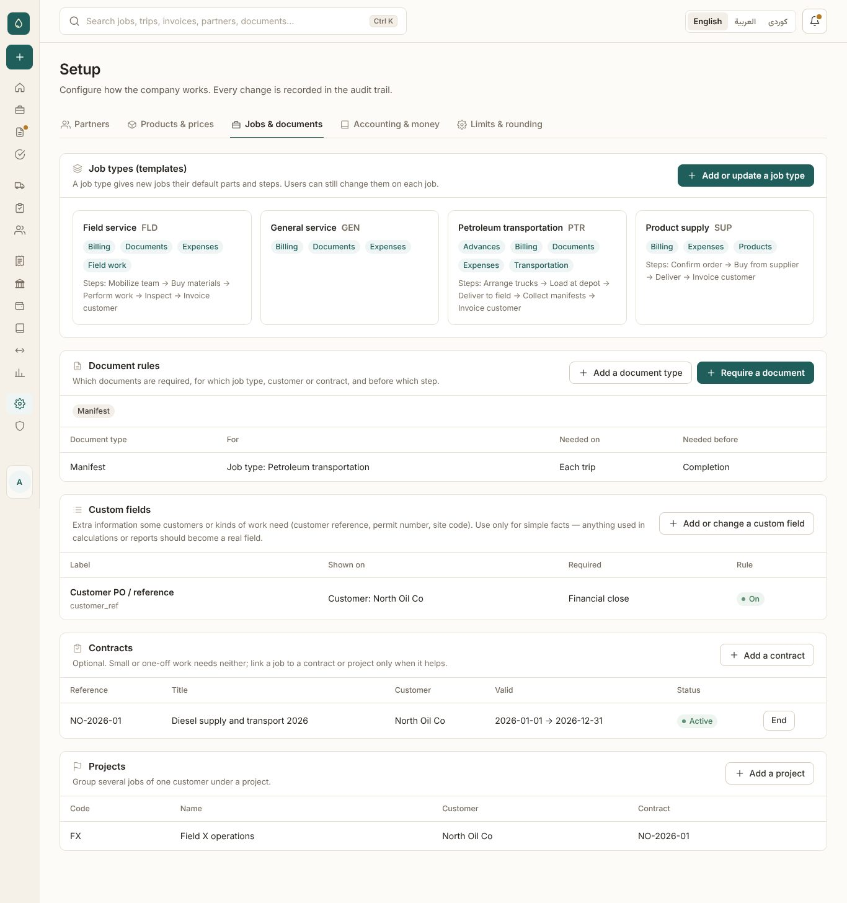

Papers can be required per job type, per customer or per contract, and for the job or for every trip. Petroleum transportation already requires a **Manifest on every trip**. Add a discharge certificate or anything a customer asks for here, not in the code.

A trip whose required papers are missing cannot be claimed. Papers that arrive together with a claim are ticked in the claim and recorded on each trip automatically.

### 5.4 People and permissions

Administration → Users & roles.

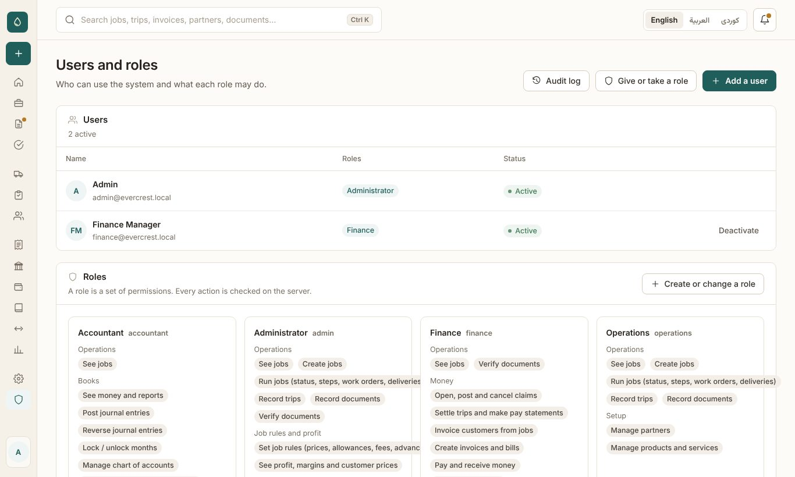

The new permissions from step 2 are in the Money group: open and post claims, waive shortage fines, approve site settlements.

---

## 6. A job and its rule card

### 6.1 Create the job

Click the **+** at the top of the side menu → New job. Only five things are needed: customer, job type, name, start date, responsible person.

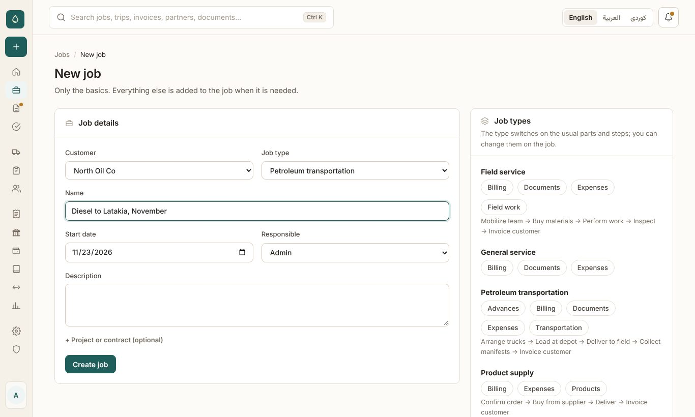

The job opens on its Overview with the **Next action**: the one thing the job is waiting for.

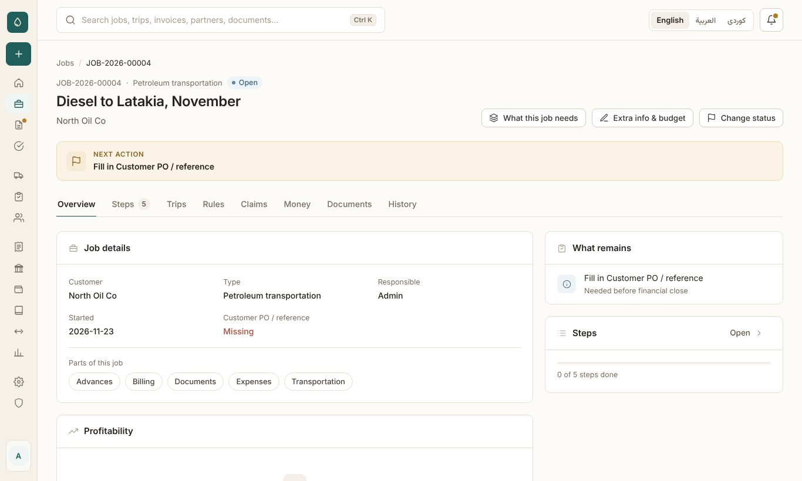

### 6.2 The rule card

Job → **Rules** tab → **New version**.

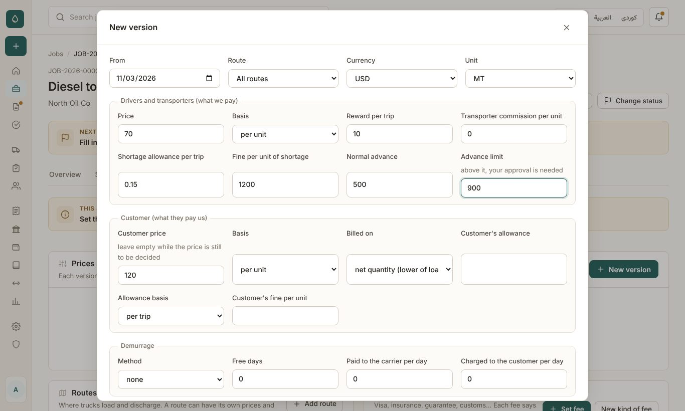

| Field | What it means |
|---|---|
| From | The date this version starts. Trips loaded on or after it use it. |
| Route | Leave empty for the whole job, or pick a route to give that route its own prices. |
| Currency, unit | The job's currency and quantity unit, e.g. USD and MT. |
| Carrier price, per ton or per trip | What the carrier earns. |
| Reward per trip | Added to every trip's freight. |
| Transporter commission | An amount per ton the transporter earns on top, if agreed. |
| Allowance | Shortage per trip the carrier is not fined for, e.g. 0.15 MT. |
| Fine price | Price per ton beyond the allowance, e.g. 1,200 USD. |
| Customer price, allowance, fine | What the customer pays and the customer's own shortage rule. Visible only with the profit permission. Leave the price empty if it is not decided yet. |
| Demurrage | Method, free days, and the rate for the carrier and for the customer. |
| Normal advance, advance limit | The usual advance, and the most that can be paid on a trip without your approval. |

**A price change is a new version from a date.** Old trips keep the old price. Nothing already calculated changes behind your back.

### 6.3 Routes and fees

Same tab, below the versions.

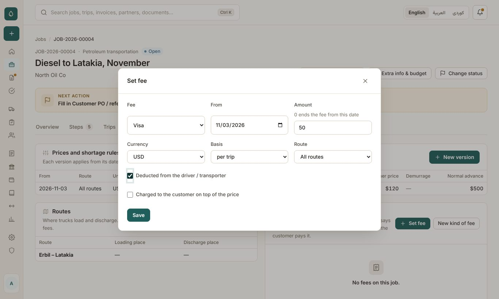

- **Routes**: where trucks load and discharge. Also created automatically from imported sheets.
- **Fees**: visa, insurance, guarantee, entry slip, declaration, border commission, customs, and any new kind you add with "New kind of fee". Each fee has an amount from a date, per trip or per ton, and two switches: **taken back from the carrier**, and **billed to the customer**.

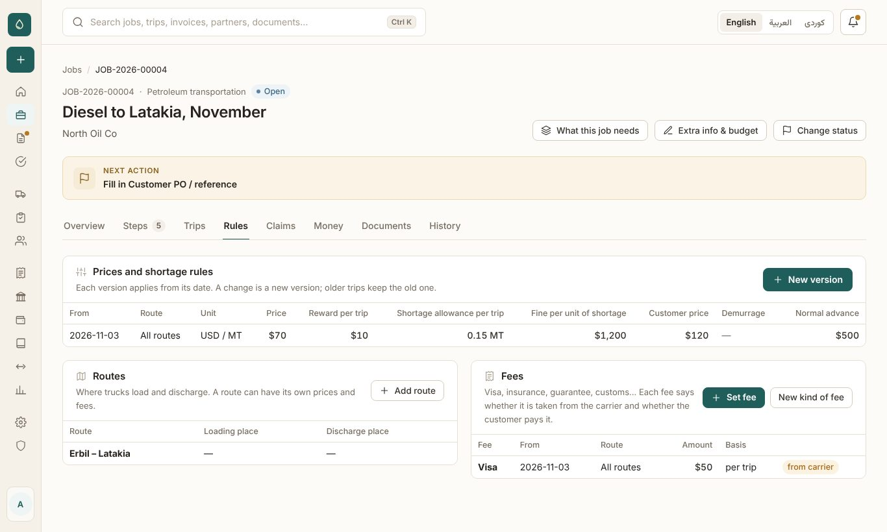

Tip from the owner's seat: fill in the rule card before the first truck loads. A trip loaded before any version exists shows "no rule" until one covers its date.

---

## 7. Trips: loading

Job → **Trips** tab.

There are four ways to enter trips. They all end in the same trips.

### 7.1 The entry line — one truck at a time

The line at the top of the trips. You type only what changes per truck:

1. **Driver.** Names are suggested as you type. For a driver seen before, the plate fills in by itself.
2. **Plate.**
3. **Manifest.**
4. **Loaded quantity**, then **Enter**.

The trip is saved, it appears in the grid, and the cursor goes back to Driver for the next truck.

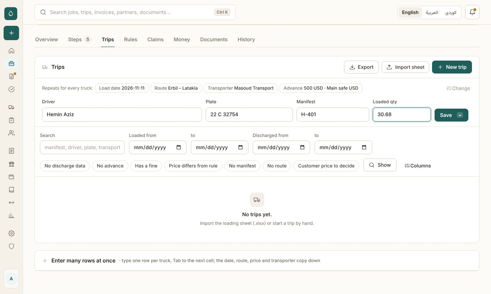

The small boxes above the line repeat for every truck: load date, route, transporter, price and reward if different from the card, and the advance with its cash box. Change them once with **Change**; they stay until changed again. An empty transporter means the driver works directly with you.

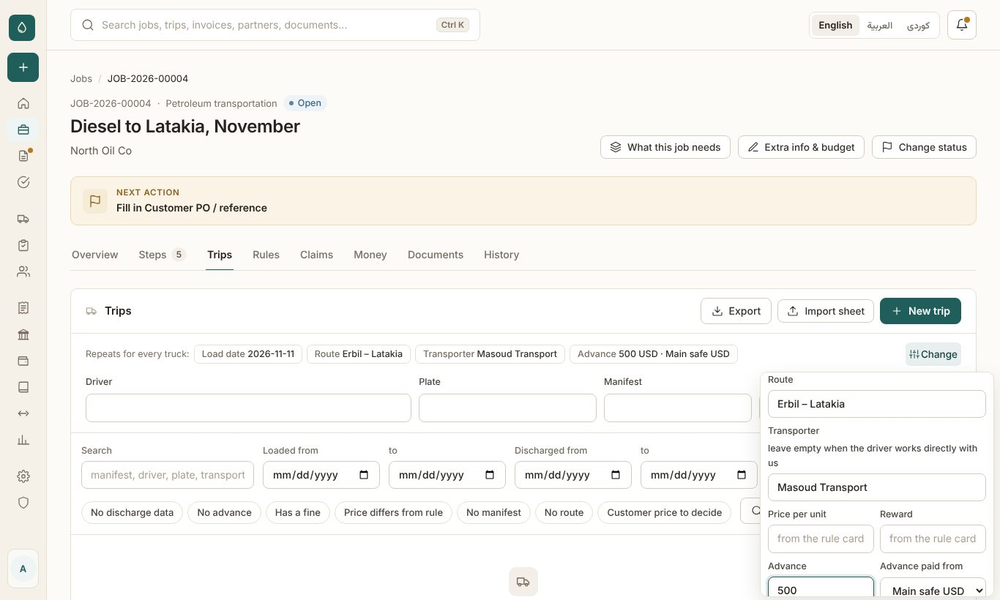

### 7.2 The full form — one trip with everything

**New trip** opens one screen with every field: manifest, route, dates, quantities, driver, transporter, plate, a price or reward for this trip only, the transporter's cut, other deductions, notes, and an advance.

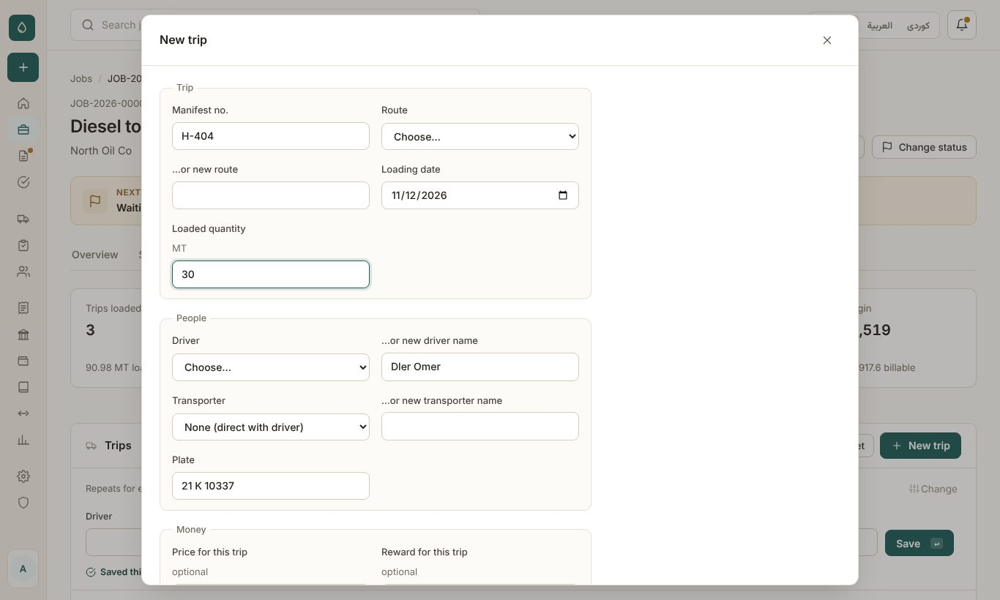

### 7.3 Import the site's sheet

**Import sheet** → choose the .xlsx file → **Preview**.

The sheet is read as the site keeps it. Headers in Kurdish, Arabic or English are recognised: load date, route, transporter, driver, plate, manifest, loaded, advance, discharge date, discharged, fees and deductions. Columns with formulas are ignored, because the system calculates them itself.

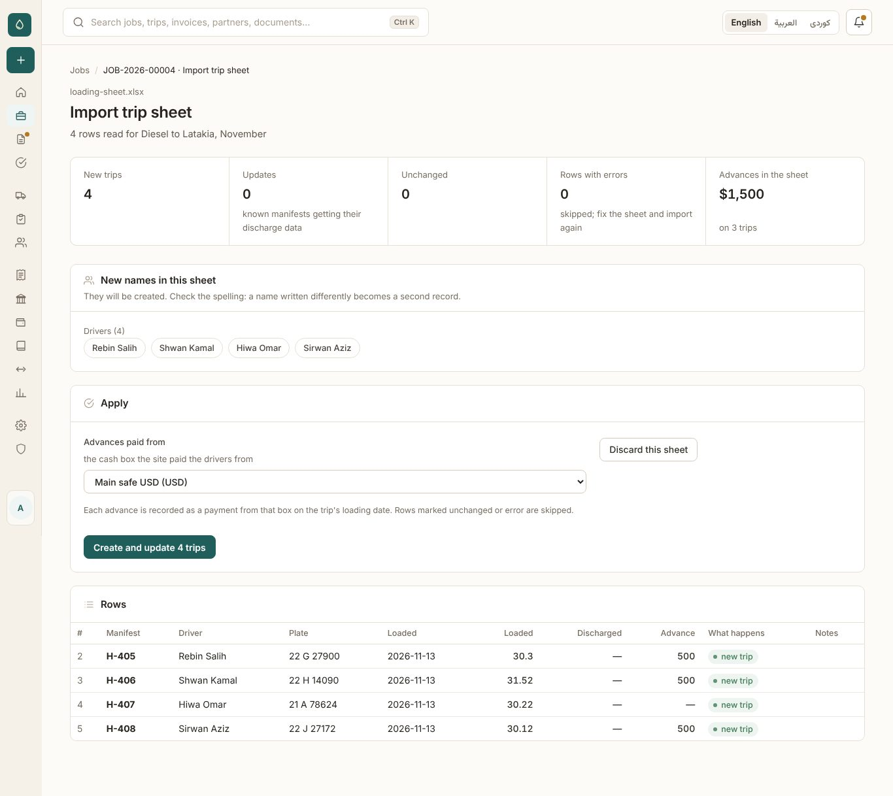

The preview shows what will happen before anything is saved: new trips, updates, unchanged rows, rows with errors and why, new names that will be created, and the advances in the sheet with the cash box they were paid from. Check the new names: a name spelled differently becomes a second person.

**Create and update** applies it once. Rows with errors are skipped; fix the sheet and import it again.

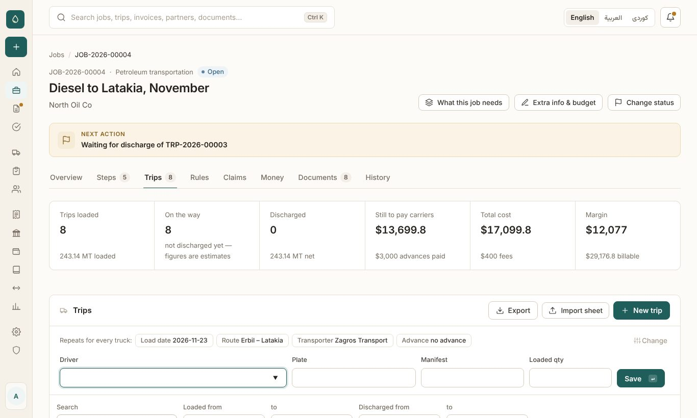

### 7.4 Many rows at once

**Enter many rows at once**, under the grid, opens a spreadsheet-like table for a batch typed from paper. One Save checks all rows together.

### 7.5 Advances

An advance paid when the trip is entered comes out of the chosen cash box straight away.

- Within the rule card's advance limit: paid without asking.
- Above the card's limit: always waits for your approval, whatever the payment limit.
- No limit on the card: the general payment limit applies.
- An advance in another currency than the job's is shown separately and never mixed into the job's currency.

A sheet import refuses advances above the card's limit; enter that one trip in the full form and send it for approval.

### 7.6 What the cards above the grid tell you

Trips loaded, on the way (not discharged, figures estimated), discharged, still to pay carriers with the advances already paid, total cost with fees, and the margin (profit permission only).

---

## 8. Discharge, corrections and how a trip is calculated

### 8.1 Import the storage's discharge list

The storage's list needs only three columns: manifest, discharge date and discharged quantity. Import it the same way.

Known manifests get their discharge data. A re-import never overwrites figures already recorded; a different figure is shown as a note instead.

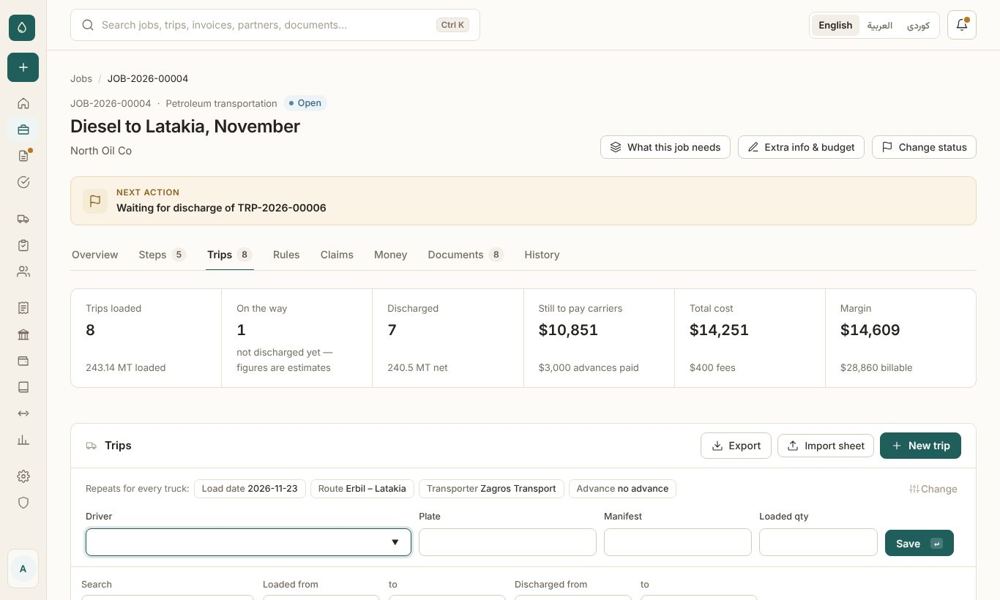

### 8.2 By hand

Open the trip (click its manifest), fill in discharge date and quantity, save.

### 8.3 Corrections

Staff correct a trip directly; mistakes are frequent and waiting for permission delays the work. Write the reason in the form. The trip's **History** shows who changed what, from what to what, and when.

Once a trip is on a claim it is locked: its money has moved. To correct it, cancel the claim first.

### 8.4 How the money is calculated — worked example

Trip H-402, from the screenshots: loaded 30.45 MT, discharged 30.1 MT.

| | Rule | Amount |
|---|---|---|
| Net | the lower of loaded and discharged | 30.1 MT |
| Shortage | 30.45 − 30.1 | 0.35 MT |
| Fined quantity | shortage beyond the 0.15 allowance | 0.2 MT |
| Freight | 30.1 × 70 | 2,107 |
| Reward | per trip | + 10 |
| Fine | 0.2 × 1,200 | − 240 |
| Visa | taken back from the carrier | − 50 |
| **Earned** | | **1,827** |
| Advance | paid at loading | − 500 |
| **To pay** | | **1,327** |

Until discharge the trip shows the same calculation with net = loaded and no shortage, marked **estimated**. After discharge it is **confirmed**.

---

## 9. Finding and checking trips

The trips grid works like a spreadsheet.

- **Search**: manifest, driver, plate, transporter.
- **Date ranges**: loaded from/to, discharged from/to.
- **Quick chips**: no discharge data, no advance, has a fine, price differs from the rule, no manifest, no route, customer price to decide.
- **Column funnels**: tick the values to show, like Excel's filter.
- **Sorting**: click a column title.
- **Columns**: "Fit to screen" hides the least important columns on small screens; tick to choose your own.
- **Export**: the rows you see, to Excel.

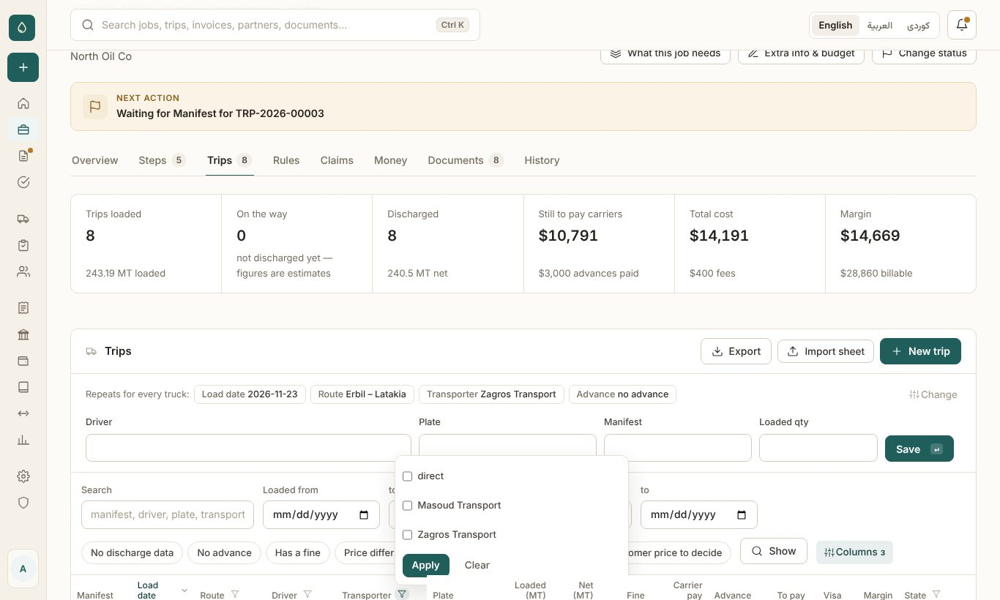

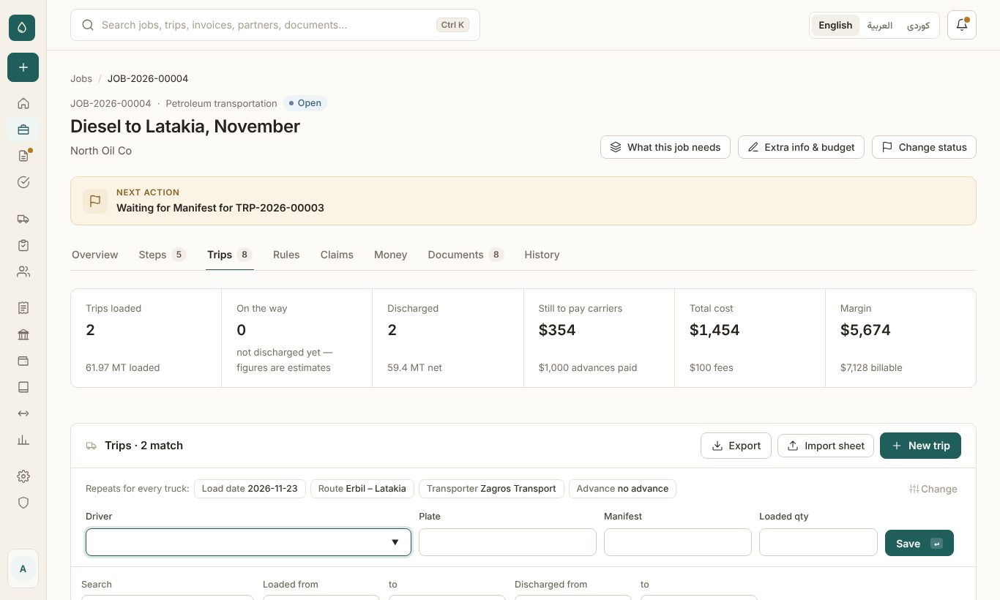

The filters live in the page address: bookmark or send a filtered view to someone.

The **Trips** page in the side menu shows all trips of all jobs with the same tools and a job filter.

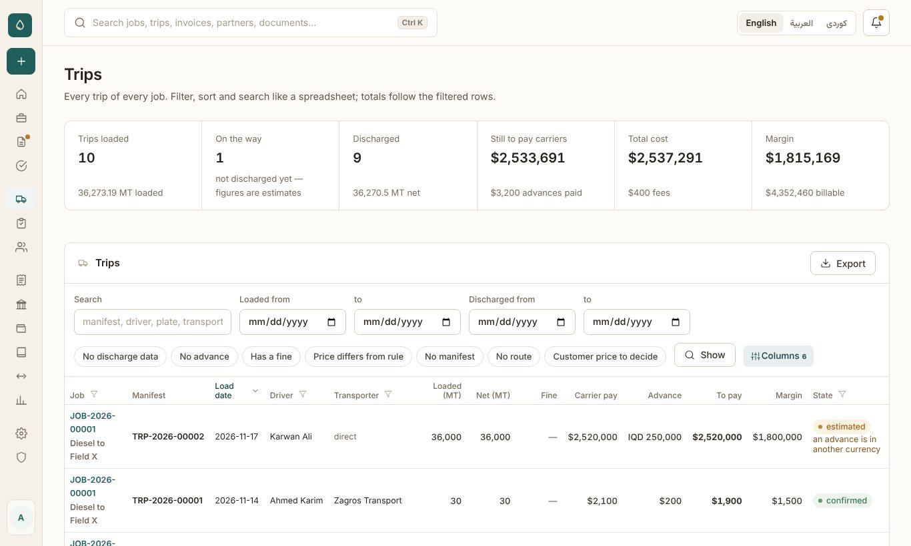

---

## 10. Papers

Job → **Documents** tab shows every required paper per trip and its state: missing, received and waiting for verification, verified, rejected or expired.

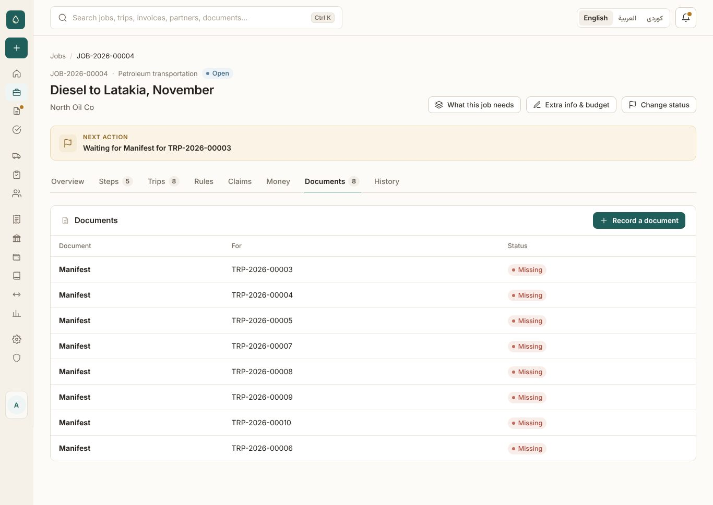

You rarely need to record manifests here one by one: when a claim is opened, tick the papers that came with it and they are recorded on every trip of the claim. A received but not yet verified paper is a warning, not a block.

---

## 11. Fine waivers

When you accept a driver's excuse for a shortage: open the trip → **Fine waiver** → amount (empty = the whole fine) and the reason → **Request a waiver**.

- It always goes to Approvals and a different person decides.
- While it waits, the trip is held back from claims, so a claim never goes out with a fine that is about to change.

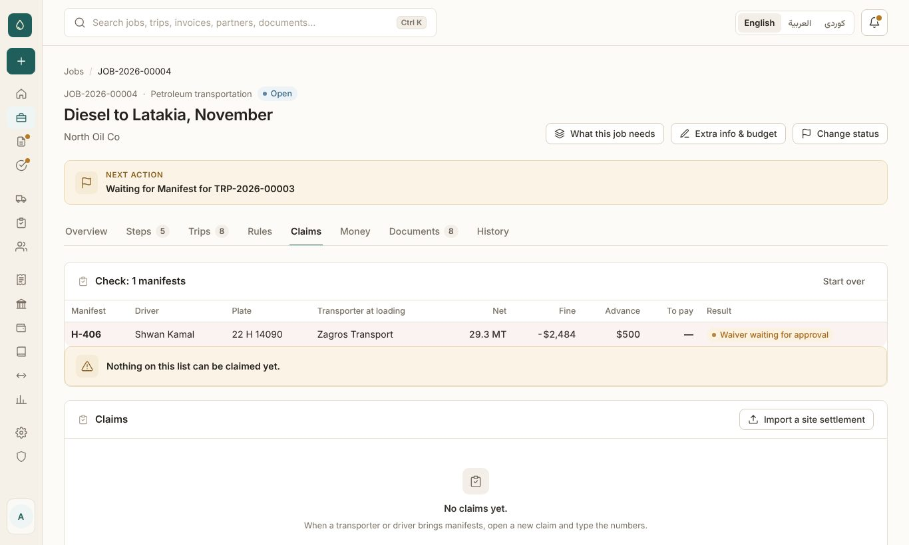

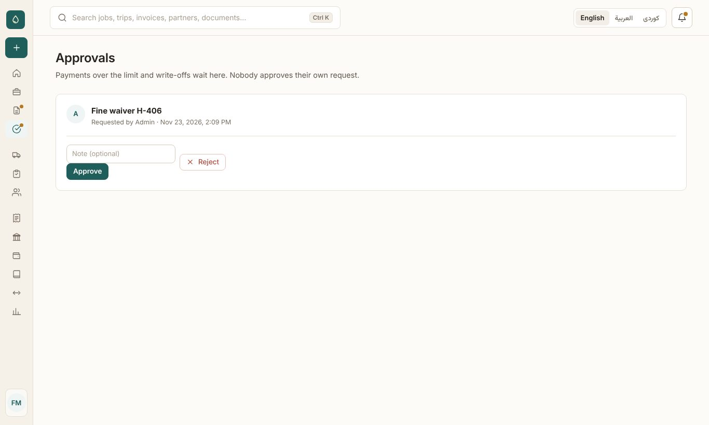

After approval the fine is reduced in the trip's calculation and in its claim. The fine itself is never edited; the waiver is a separate record with its reason.

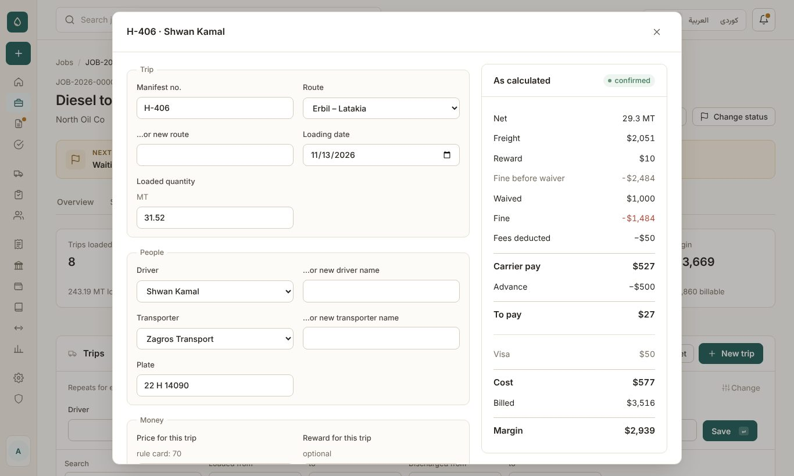

A waiver is only possible before the trip is claimed.

---

## 12. Claims

### 12.1 Open a claim

Job → **Claims** tab → **New claim**.

1. **Claimant**: the transporter or the driver who brought the papers. A new name becomes a new transporter.
2. **Date.**
3. **Manifest numbers**: one per line, or separated by commas. Type, paste or scan them.
4. **Papers that came with this claim**: the Manifest is ticked; tick any other paper they brought.
5. **Check the manifests.**

### 12.2 The check

Every manifest gets a result before anything is created:

| Result | Meaning | What to do |
|---|---|---|
| Ready | Can be claimed; amount shown | — |
| No such manifest in this job | Wrong number, or another job's trip | Check the paper |
| No discharge data yet | Not discharged | Import or enter discharge |
| Papers missing | A required paper is not there | Tick it if it came with the claim, or record it |
| Waiver waiting for approval | A fine waiver is undecided | Decide it in Approvals |
| Already claimed | On another claim (number shown) | Nothing: it cannot be paid twice |
| Already paid by settlement | Paid the old way, before claims existed | Nothing |
| Listed twice | The same number typed twice | — |
| No rule card for its date | No version covers its loading date | Add a version |

If some lines are not ready, **Claim only the ready trips** keeps the good ones.

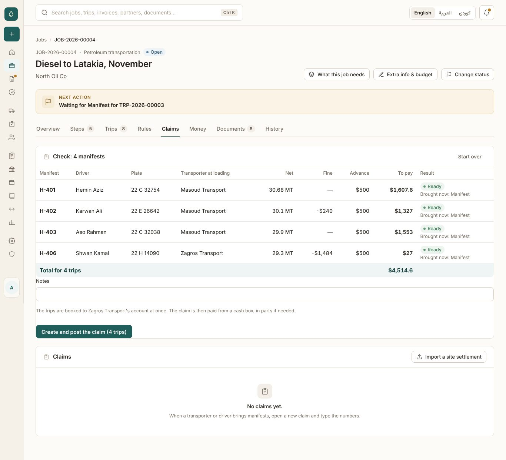

### 12.3 Post the claim

**Create and post the claim** opens the claim page, laid out like your settlement form.

The first figure at the top is the one to act on: what the company still owes the claimant. Below the trips, **How the amount is worked out** walks from freight to the amount to pay, ending on a green line; people who may see the books also get **In the books**, the claim's debit and credit lines, which always come to the same total on both sides.

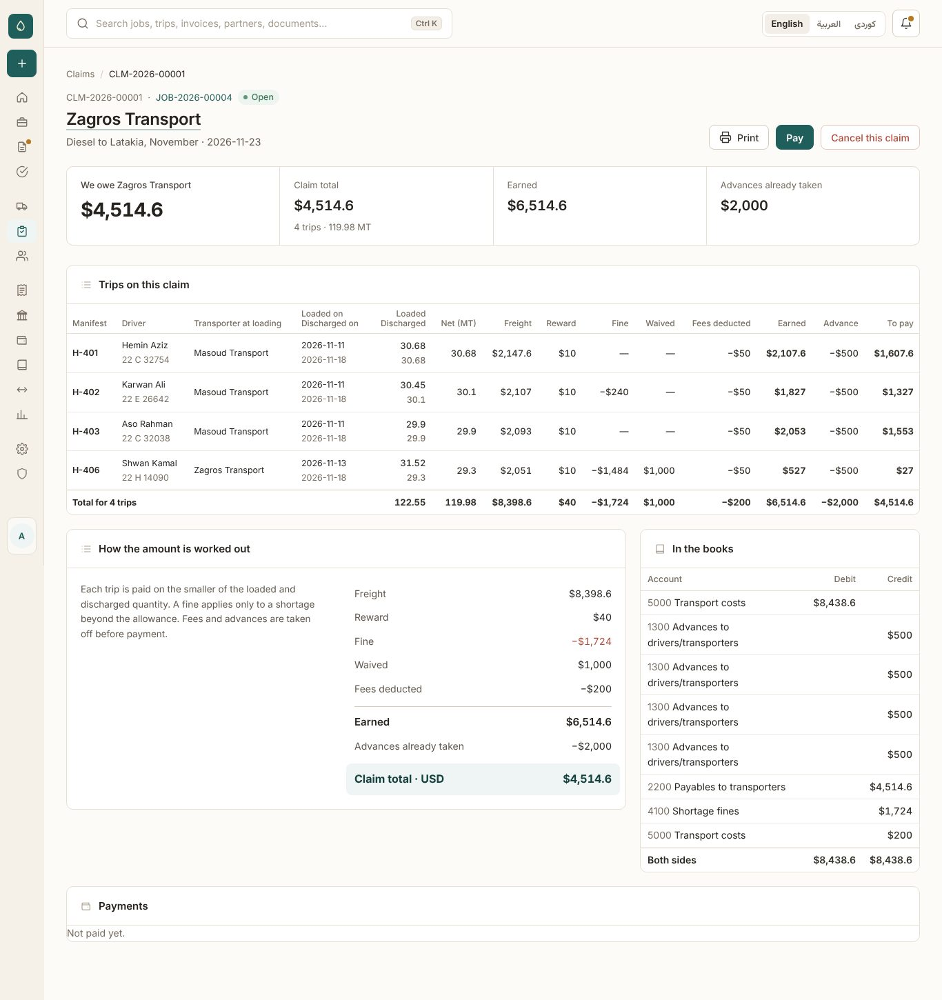

At that moment:

- the claimant's account shows what the company owes them;
- the advances paid on those trips are cleared, from whoever received them;
- the trips are locked and can never be claimed again by anyone;
- the claim's total is rounded once.

Money follows the papers: in the example Zagros Transport brings four manifests, three of them loaded with Masoud Transport's trucks. Zagros is paid for all four. Masoud is owed nothing for them.

A trip whose fine is bigger than its pay has a negative amount. It is offset inside the claim. If the whole claim is negative, the claimant owes the company and the button says **Collect**.

### 12.4 Pay the claim

Claim page → **Pay** → amount (empty = everything still open) → cash box → date → method.

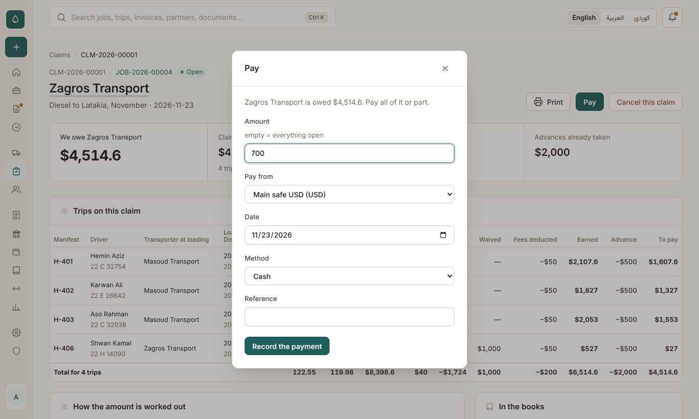

Pay all or part. Each payment shows on the claim and the claim's "Still to pay" goes down.

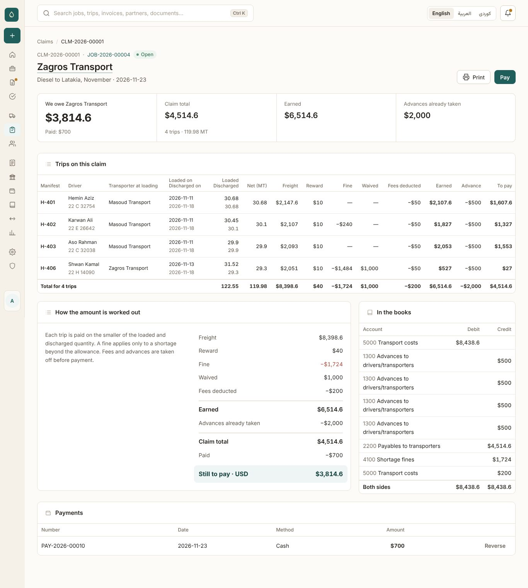

A payment above the payment limit asks for approval. **Send for approval** puts it in Approvals.

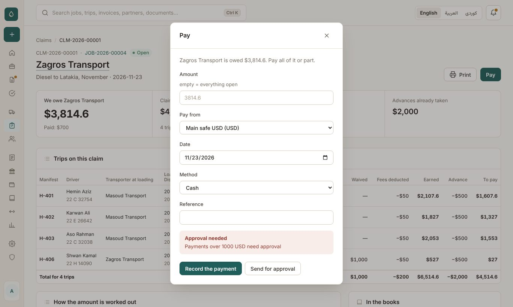

When nothing is left open, the claim shows **Paid**.

A claimed trip shows a green "Claimed" notice in its form and is locked.

### 12.5 Cancel a claim

**Cancel this claim** with a reason. The trips become claimable again and the booking is reversed. A claim with payments cannot be cancelled: reverse its payments first, with **Reverse** next to each payment on the claim page. Reversing needs the "reverse payments" permission.

---

## 13. Site settlements

When a site paid the drivers with its own figures and sends back a sheet.

Job → Claims tab → **Import a site settlement** → the sheet, the date paid, the site's cash box → **Compare**.

The sheet needs a manifest column and an amount paid column; driver, plate, fine and advance columns are kept for reference. Headers in any of the three languages.

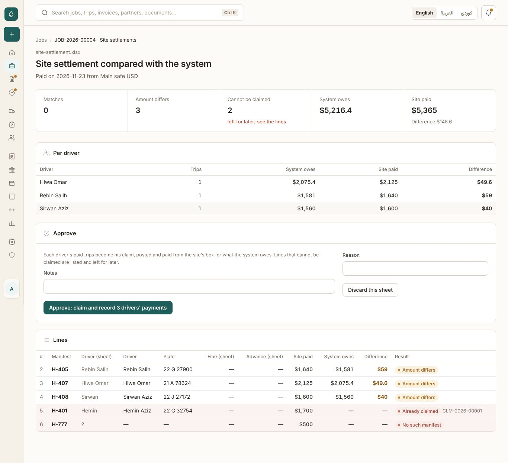

The comparison shows:

- how many lines match, how many differ, and how many cannot be claimed and why;
- per driver: what the system says is owed, what the site paid, and the difference;
- every line, with the result.

**Approve** turns each driver's paid trips into that driver's claim and records the payment from the site's cash box for what the system says is owed. Lines that cannot be claimed are listed and left for later. If the payments are above the limit, the whole settlement waits for approval.

The difference is what the site paid too much (positive) or too little (negative). It stays visible here and, from step 3, appears in that cash box's count, so it is followed up with the site's employee.

---

## 14. Approvals

Side menu → **Approvals**. Everything waiting for a second person:

- advances above a job's advance limit;
- payments above the payment limit;
- fine waivers;
- site settlements above the limit;
- write-offs.

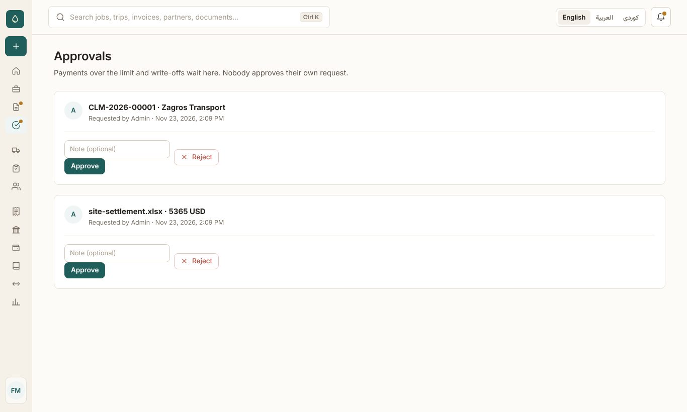

Approve or reject with a note. Nobody can approve their own request. An approved request runs exactly as it was submitted.

---

## 15. Where the money shows in the books

The books hold only real events. While trips are loading, the system calculates profit live from the trips; it does not book estimates.

| Event | What the books record |
|---|---|
| Advance paid | Cash box down; advance owed by that driver or transporter |
| Claim posted | Trips' earnings as a job cost; fines and recovered fees against it; advances cleared; the claimant is owed the net |
| Claim payment | Cash box down; the claimant is owed less |
| Fine waiver | No entry of its own; the claim is smaller |
| Site settlement approved | A claim and a payment per driver, as above |
| Claim cancelled | The claim's entry reversed |

Where to see it:

- **Partner accounts** → the carrier: balance, claims and every movement. On a claim page, click the claimant's name.

- **Journal**: every entry, each linked to its claim or payment number.

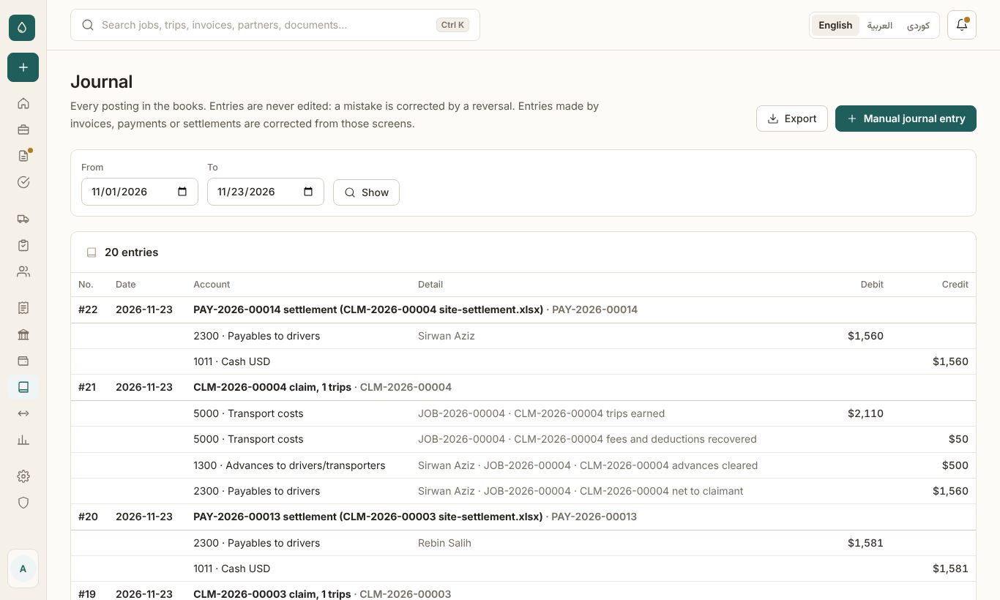

- **Cash, bank & books**: each cash box's balance.

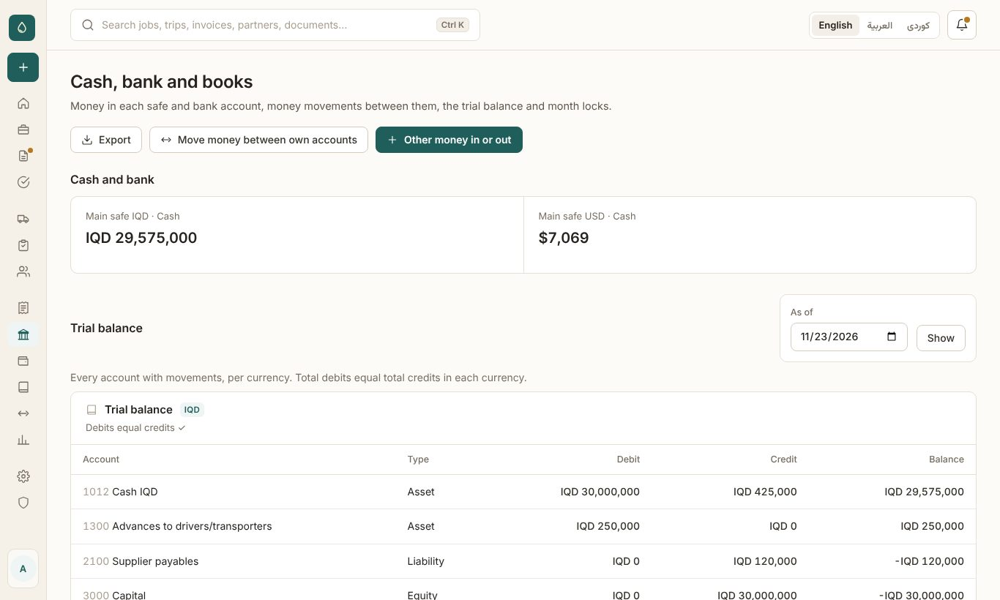

---

## 16. Where to find everything

| What | Where |
|---|---|
| A job's trips, rules, claims, papers | Jobs → the job → tabs Trips, Rules, Claims, Documents |
| All trips of all jobs | Side menu → Trips |
| All claims and their status | Side menu → Claims |
| What a carrier is owed | Partner accounts → the name, or click the claimant on a claim |
| What waits for you | Side menu → Approvals (a dot shows when something waits) |
| Cash box balances | Cash, bank & books |
| Every booking | Journal |
| Cash boxes, limits, papers | Setup |
| People and permissions | Users & roles |

The side menu is a strip of icons; move the mouse onto it to open it, or pin it open with the arrow at its bottom.

---

## 17. What can go wrong and how to fix it

| Situation | What to do |
|---|---|
| A quantity or date was typed wrong | Open the trip, correct it, write the reason. If the trip is claimed, cancel the claim first, correct, claim again. |
| The same manifest typed twice | The system refuses it. Check which trip is right. |
| A trip shows "no rule" | Add a rule card version whose date covers the trip's loading date. |
| A sheet is refused or columns are not read | The preview lists the columns it recognised. Rename the header to one of the recognised names, or ask for it to be added. |
| A name in a sheet was spelled differently | It becomes a new person. Correct the trip to the right driver; names will be merged in a later step. |
| An advance went out from the wrong cash box or in the wrong currency | Open the trip → History → "Reverse this advance" with the reason, then pay it again from the right box. Only before the trip is claimed. |
| The wrong claimant was chosen | Cancel the claim and open it again for the right person. |
| A claim was paid from the wrong box | Claim page → Payments → "Reverse" with the reason. The money is back in the box and the claim opens again for that amount. |
| The site's figures differ | The comparison shows each difference. Approve what the system owes; follow up the difference with the site's employee. |
| An approval was rejected | Nothing happened. Correct the request and send it again. |
| The old "Settle this trip" button in the Settlement and billing box | From the first draft. A claimed trip cannot be settled that way, and a trip settled that way cannot be claimed. Use claims for all jobs with a rule card. |

---

## 18. A daily and weekly rhythm

From the owner's seat, so normal work stays quiet and exceptions stand out:

**Every day**
- Trip clerk: enter or import the day's loading before closing. Advances only within the card's limit.
- Documents and claims clerk: import discharge lists as they arrive; open claims as papers come in.
- Cashier: pay open claims from the right box.
- You: clear Approvals once a day.

**Every week**
- Trips page, chip "No discharge data": trucks not discharged after the usual days — chase them.
- Chip "Has a fine": shortages to discuss with carriers before claims.
- Claims page, "Open": what is still owed to carriers.
- Site settlements: compared within two days of the sheet arriving.

---

## 19. Try it — checklist

1. Create a job for a real customer and fill in the rule card with your real prices.
2. Add a route and two fees, one taken back from the carrier.
3. Enter three trucks on the entry line, with an advance.
4. Enter one trip in the full form, direct with the driver.
5. Import a real loading sheet from a site.
6. Import a discharge list with manifest, date and quantity.
7. Correct one trip and read its History.
8. Use the chips and the column funnels to find trips with fines.
9. Request a fine waiver; approve it as a second user; see the trip change.
10. Open a claim by a transporter who did not load those trucks; include one wrong number; claim only the ready trips.
11. Pay part of the claim, then the rest above the limit; approve as a second user.
12. Try to claim one of those manifests again.
13. Import a site settlement sheet with one difference; approve it.
14. Open the carrier's account and the journal and follow each entry back to its claim.
15. Switch the language to Kurdish and Arabic and repeat one claim.

---

## 20. Not built yet

| What | When |
|---|---|
| Counting cash boxes; site differences landing on the site's box; daily rate; exchangers; paying in the other currency | Step 3 |
| The accountant's review queue; the month-end accrual for trips waiting for papers | Step 4 |
| Customer invoicing from the rule card; customer advances; receivables by age. The old "Invoice the customer" button uses the first draft's price list: do not rely on it for jobs with a rule card | Step 5 |
| Roles rebuilt around your staff; "my work" lists; your owner board and phone view | Step 6 |
| Storage, shared overheads, staff and payroll, several companies | Step 7 |
| Accident or contamination recovery charged to a carrier | To be scheduled |
| Paying part of a carrier's whole balance across several claims, oldest first | To be scheduled |
| Merging two spellings of the same driver | To be scheduled |
| Saved filter groups | Your decision pending |
| Extra papers and costs for jobs abroad (question #43) | Your answer pending |
