# Chapter 1 — Trips and claims

Build steps 1 and 2, with your corrections of November 2026. Status: ready for your review.

---

## 1. In one minute

Before: the site keeps its loading sheet, the office copies it into its own file, someone sets the price and reward per trip by hand, discharge figures arrive late, settlements are calculated in Excel, the accountant types the journals, and sites that pay drivers with their own figures send back sheets that take days to check.

Now:

- **Each job has a rule card.** Prices by route, reward, shortage allowance and fine, and the advance limit are set once per job. Every trip is calculated from it automatically.
- **Fees are ticked on the trip.** The kinds of fees, with their usual amount and who pays them, are set up once. Operations tick the fees each truck really had, and pay them later in one payment.
- **Trips go in once.** Imported from the site's own sheet, entered in full, or typed as many rows at once. The manifest number is the trip's identity and can never be entered twice in a job.
- **Discharge fills in later.** Until a trip is discharged its figures are marked "estimated". The storage's discharge list is imported as it is.
- **Money follows the papers.** Whoever brings a trip's manifest is paid for it, through a claim. A trip can be claimed once. The system calculates the claim exactly like your settlement form and books it to the claimant's account.
- **Site settlements are compared, not re-checked by eye.** The site's sheet is imported and compared line by line; only differences need attention.
- **A paper that will never come** is marked "Paper not coming" with a reason and, after your approval, counts as complete everywhere.
- **Two people for money above the limits.** Large payments, advances above the card's limit, fine waivers and large site settlements wait for a second person.

---

## 2. Which of your problems this solves

| Your problem | Where you said it | What the system does now |
|---|---|---|
| Site data is copied by hand into the office's own files | Part 2, Q4 | The site's sheet is imported as it is, in Kurdish, Arabic or English headers. Or entered once in the trip form. |
| Price, reward and route are set trip by trip | Part 2, Q4 | The rule card sets them once per job, with a price per route; a change is a new line from a date. Exceptions per trip are allowed and flagged. |
| Discharge data comes back late, sometimes only when the driver returns | Part 2, Q4 | Trips stay "estimated" until discharge; the storage list fills them in; nothing is paid on estimates. |
| The transporter at loading is not the one who brings the papers | Part 4, D4 | The claimant is chosen when the papers come back. The trip's advance and fines stay with the trip. |
| A fine larger than the pay | Part 4, D7 and D11 | The trip's negative amount is offset inside the claim; a negative claim is collected from the claimant. |
| Fees paid for the carrier and taken back later | Part 4, D10 | Each kind of fee says who pays it at the time, and who carries it in the end: the company, the carrier (taken back) or the customer. A fee the customer paid and the carrier gives back is owed back to the customer automatically. |
| A paper that will never arrive blocks the job forever | Your review, 5.3.2 | "Paper not coming", with a reason and your approval; a received paper no longer blocks anything. |
| Several people work on one job | Your review, 6.1 | One responsible person plus a team; "My jobs" shows each person their jobs. |
| Remote settlements with the site's own figures, wrong payments, delays | Part 2, Q5 and part 12 | Import the site's sheet; see matches and differences per trip and per driver; approve once. |
| Settlement journals typed by hand and wrong | Part 9, Q4 | Posting a claim and paying it create the journal entries; the accountant only reviews. |
| Not knowing who did what | Part 11, Q1 | Every change records who, when, what it was before and after, and why. |
| Payments without control | Part 9 | Payment limit, advance limit and fine waivers go through Approvals; nobody approves their own request. |

---

## 3. Who does what

Today's roles are the starter set; step 6 rebuilds them around your five office staff. Until then, give people these roles in Administration, Users & roles.

| Work | Suggested person | Role today |
|---|---|---|
| Set up cash boxes, limits, required papers | You or the administrator | Administrator |
| Set up the kinds of fees | You or the accountant | Administrator |
| Create jobs and fill in the rule card | Operations lead, checked by you | Administrator, or Operations plus the "Job rules" permission |
| Be on a job's team | Anyone working on the job | Any role. Being on a team gives no extra rights. |
| Enter or import loading, advances, discharge, tick fees | Trip clerk (site or office) | Operations |
| Record papers, open claims | Documents and claims clerk | Finance (has the claims permission) |
| Pay claims and fees from a cash box | Cashier | Finance |
| Approve large payments, waivers, papers not coming, site settlements | You | Administrator or anyone with "Approve" — never the person who asked |
| Review the books | Accountant | Accountant |

Margins and the customer's price are visible only with the profit permission. Staff without it never see profit.

---

## 4. The whole flow at a glance

1. Once: cash boxes, limits, kinds of fees, job types and required papers, people.
2. Create the job, with its team.
3. Fill in its rule card: job-wide rules and prices by route.
4. Trucks load: enter or import the trips, with advances and the fees each truck had.
5. Trucks discharge: import the storage list or enter by hand.
6. Corrections, if any, with a reason.
7. A fine waiver, if you forgive a fine. Before the claim.
8. Papers come back: open a claim, check, post. A paper that will never come: "Paper not coming".
9. Pay the claim from a cash box, all or in parts. Pay the fees in one payment.
10. Sites that paid drivers themselves: import their sheet, compare, approve.
11. You approve what waits in Approvals.
12. Everything shows in the carrier's account, the cash box and the journal.

---

## 5. Once, before any job

### 5.1 Cash boxes

Setup → Accounting tab.

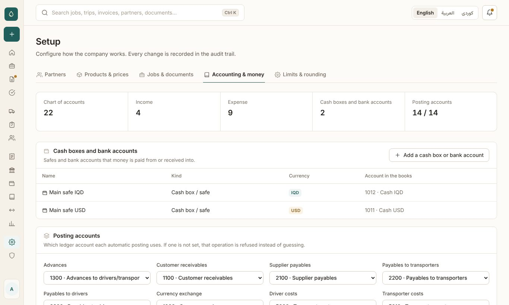

Each safe, site box or bank account is a cash box with one currency. Click **Add a cash box or bank account** and type only the name, the kind and the currency. The box gets its own account in the books automatically, named after it and numbered for you: cash boxes from 1011 to 1049, bank accounts from 1051 to 1099. Advances, claim payments and site payments come out of a cash box, so its balance is always known.

In the **Accounts** list below, every account has **Edit** to change its name; its number, type and currency stay, so postings already made keep their meaning. **Delete** appears only on an account nothing uses yet (no postings, no cash box, not used by the automatic postings), for example one typed by mistake.

Benefit: you see what each box should hold. Step 3 adds counting and reconciling each box.

### 5.2 Payment limit and rounding

Setup → Settings tab.

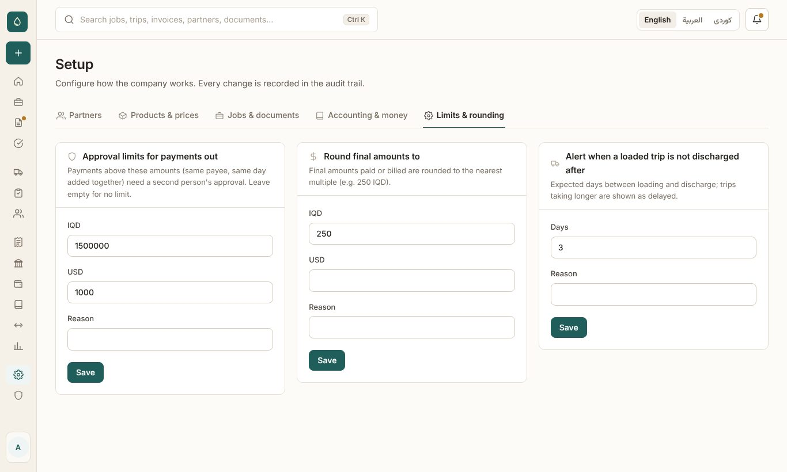

- **Payment limit per currency.** A payment out above it waits for a second person. Payments to the same person on the same day are added together, so a large payment cannot be split to get through.
- **Rounding.** Final amounts are rounded to this step, for example 250 IQD. Only the final amount of a claim is rounded, once; the difference is booked to its own account.

### 5.3 Jobs and documents: the five parts

Setup → **Jobs & documents** tab.

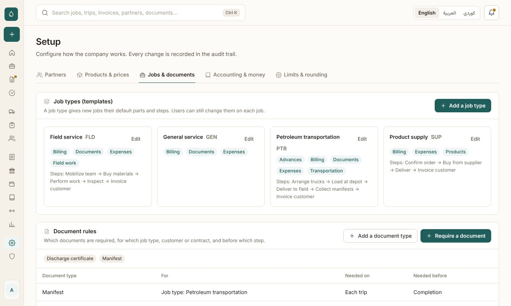

This tab decides how a new job starts, which papers each job needs, which extra facts some jobs must carry, and how jobs can be grouped. It has five parts, top to bottom:

| Part | In one sentence | Needed? |
|---|---|---|
| **1. Job types** | The kinds of work you do, each with the parts and steps a new job of that kind starts with. | **Yes.** No job can be created without a job type. |
| **2. Document rules** | Which papers are required, for which jobs, and before which step. | **Yes** for transport: the Manifest rule. Otherwise when a customer asks for a paper. |
| **3. Custom fields** | Extra facts some jobs must carry, like a customer's PO number or a field permit number. | Only when needed. |
| **4. Contracts** | A customer's agreement, so jobs and prices can be tied to it. | Optional. |
| **5. Projects** | A folder that groups several jobs of one customer. | Optional. |

**On your live system all five are empty**, because of the fresh start. Set up parts 1 and 2 before the first job, in the order shown in 5.3.6. Parts 3 to 5 can wait until you need them.

Before contracts and projects you need the customer itself: Setup → **Partners** → **Add a partner**, with the role Customer.

#### 5.3.1 Job types

A job type is a template. When someone creates a job and picks its type, the job starts with the type's **parts** switched on and its **steps** already listed. The person can still change both on that one job. The type only gives the starting point and controls nothing after that.

**Add a job type** → name, the parts to switch on, and the checklist steps, one per line → **Save**. The code (JT-001, JT-002…) is given automatically.

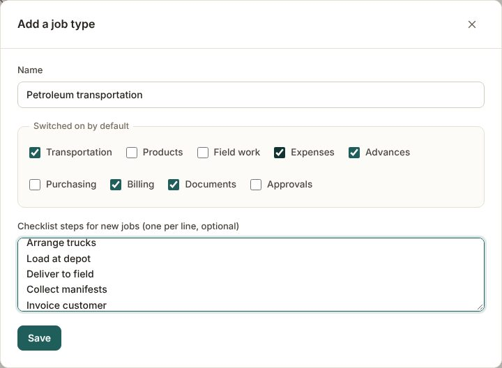

**What each part switches on in a job:**

| Part | What appears in a job that has it |
|---|---|
| **Transportation** | The **Trips**, **Rules** (the rule card) and **Claims** tabs: trucks, drivers, transporters, loading and discharge, the claim process. |
| **Advances** | The advance field when a trip is entered, and paying advances from a cash box. Needs Transportation to be useful. |
| **Billing** | **Invoice the customer** from the job's trips or deliveries. |
| **Expenses** | Recording costs on the job (fuel, a repair, a fee paid) from the job's **Money** tab. |
| **Products** | The **Deliveries** tab: products, quantities and units delivered to the customer. |
| **Field work** | The **Work orders** tab: work at a site, with its own completion. |
| **Documents** | Marks a job that works with papers. The **Documents** tab itself shows as soon as any document type exists, and **document rules apply whether or not this part is on**. |
| **Purchasing**, **Approvals** | Markers for now. Nothing extra appears yet; they are kept for later steps. |

**Steps** are a short checklist for the job (Arrange trucks → Load → Deliver → Collect manifests → Invoice customer). They appear in the job's **Steps** tab, where people tick them off. Steps from the job type are reminders. A step can be made *required* on a job; a required step must be done (or skipped with a reason) before the job can be completed.

**Edit** on a job type changes its name, parts and steps. The change applies to jobs created from then on. Jobs that already exist keep what they started with.

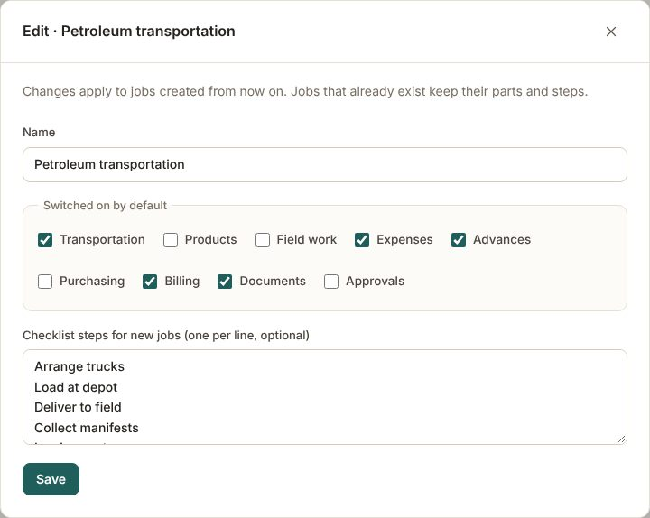

**On a single job**, the button **What this job needs** switches parts on or off for that job only, for example adding Expenses to one transport job. A part cannot be switched off once the job already has records of it (trips, deliveries, work orders).

**Recommended job types for your work:**

| Job type | Parts | Steps |
|---|---|---|
| Petroleum transportation | Transportation, Advances, Billing, Expenses, Documents | Arrange trucks · Load at depot · Deliver to field · Collect manifests · Invoice customer |
| Product supply | Products, Billing, Expenses | Confirm order · Buy from supplier · Deliver · Invoice customer |
| Field service | Field work, Billing, Expenses, Documents | Mobilize team · Buy materials · Perform work · Inspect · Invoice customer |
| General service | Billing, Expenses, Documents | none |

Keep the list short. A new kind of work becomes a new job type only when it really starts differently. A one-off variation is handled on the job itself with **What this job needs**.

#### 5.3.2 Document rules

Two steps: first name the paper (a **document type**), then say when it is required (a **rule**).

**Add a document type** → the paper's name, e.g. Manifest, Discharge certificate, Delivery note, Completion certificate → **Save**. A document type alone requires nothing. It only makes the paper known, so it can be recorded and ticked when it arrives.

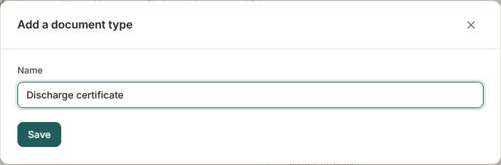

**Require a document** creates the rule:

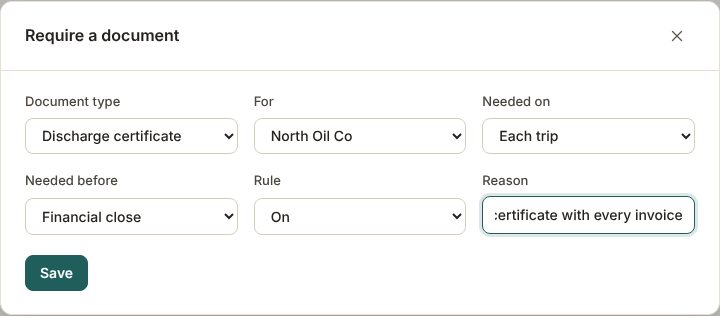

| Field | What to choose |
|---|---|
| **Document type** | The paper. |
| **For** | Who the rule applies to: a **job type** (every job of that kind), a **customer** (every job for that customer), or a **contract** (every job under that contract). |
| **Needed on** | **Each trip** (one paper per truck, like the manifest) or **the job** (one paper for the whole job, like a completion certificate). |
| **Needed before** | **Completion**: the job cannot be marked completed while the paper is missing. **Financial close**: the work can be completed, but the job cannot be financially closed until the paper is there. |
| **Rule** | **On** creates or changes the rule. **Off** removes it. |
| **Reason** | Why. Kept in the audit trail. |

How the rules work together:

- **They add up.** A Petroleum transportation job for North Oil Co under contract NOC-2026-14 needs the papers of all three: the job type's, North Oil Co's and the contract's.
- **The same paper twice: the stricter one wins.** If one rule says "before completion" and another "before financial close", the paper is needed before completion.
- **Received is enough.** A paper that is received (verified or not) no longer holds anything back. A missing, rejected or expired paper shows in **What remains** and in the Next action until it arrives.
- **A paper that will never come.** Use **Paper not coming** on its row (section 10). With your approval it counts as complete everywhere.
- **Trip papers also guard claims.** A trip whose required papers are missing cannot go on a claim. Papers that arrive with the claim are ticked on the claim and recorded on every trip automatically.
- **Changing a rule:** use **Require a document** again with the same paper, the same "For" and the same "Needed on", and pick the new "Needed before". To remove it, choose **Rule: Off**.

Typical rules:

| Paper | For | Needed on | Needed before |
|---|---|---|---|
| Manifest | Job type: Petroleum transportation | Each trip | Completion |
| Discharge certificate | Customer: the customer who asks for it | Each trip | Financial close |
| Delivery note | Job type: Product supply | The job | Completion |
| Completion certificate | Job type: Field service | The job | Financial close |

#### 5.3.3 Custom fields

Extra facts some jobs must carry, without changing the system: a customer's PO or reference number, a field permit number, a site code.

**Add or change a custom field**:

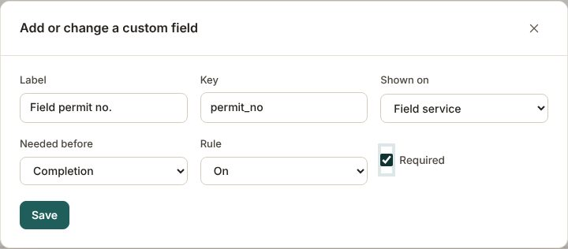

| Field | Meaning |
|---|---|
| **Label** | What people see, e.g. "Field permit no.". |
| **Key** | A short internal name in small English letters, digits and _, e.g. `permit_no`. It identifies the field and is never shown to staff. |
| **Shown on** | **All jobs**, one **job type**, or one **customer**'s jobs. |
| **Needed before** | When the field is required: before completion or before financial close. |
| **Rule** | On or off. Off hides the field from new entries without losing what was typed. |
| **Required** | Tick it if the job cannot move on without it. Leave it unticked for a field that is only useful. |

Where it shows: on the job, **Extra info & budget**. The value then appears in the job's details. A required field that is empty appears in **What remains** and becomes the Next action.

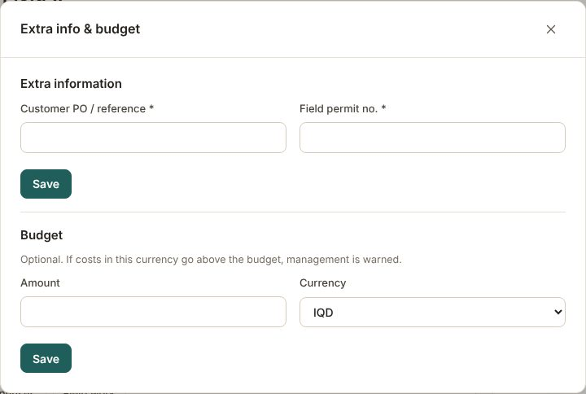

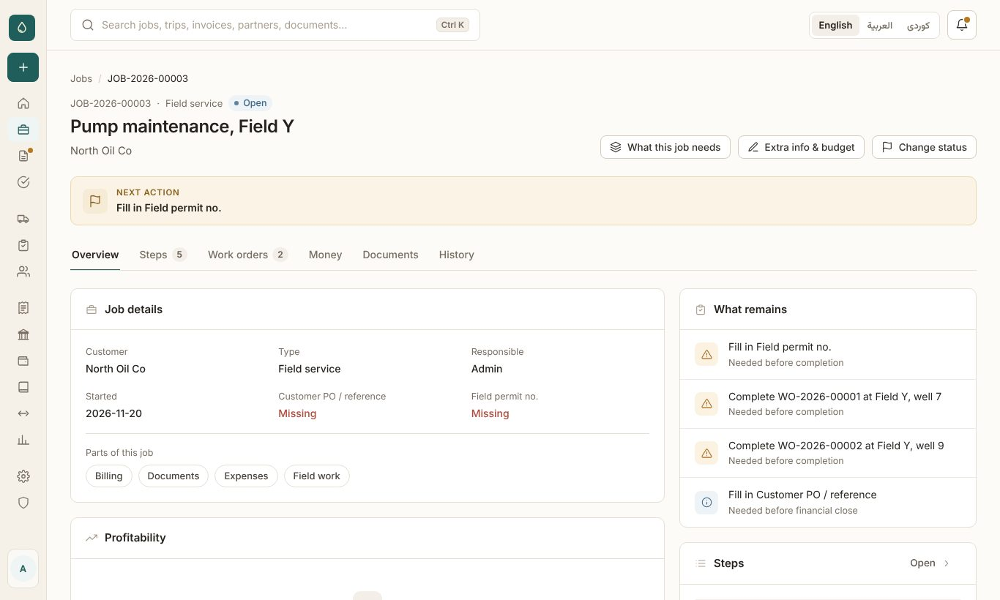

To change a field, use **Add or change a custom field** again with the **same key**: the label, where it shows and whether it is required are updated.

Use custom fields only for simple facts. Anything used in calculations, prices, totals or reports (a quantity, a price, a date that drives a fine) must become a proper part of the system: ask for it, don't make it a custom field.

#### 5.3.4 Contracts

A contract records a customer's agreement: **customer**, your **reference** (e.g. NOC-2026-14), a **title**, the **status** and the **valid from / to** dates. Optionally the **payment terms** (days the customer has to pay) and **notes**.

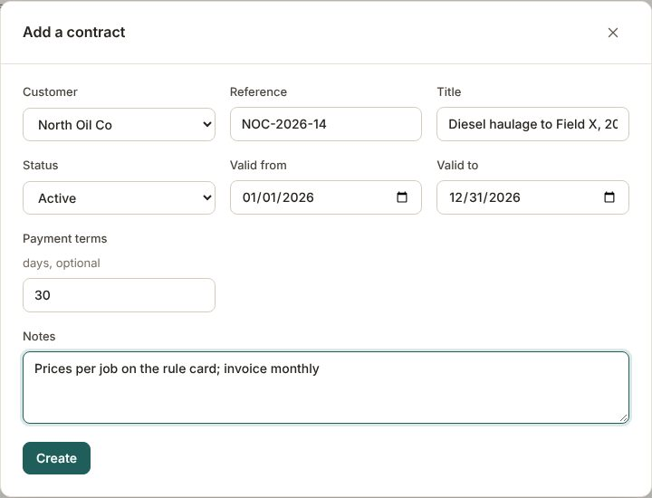

What a contract is used for:

- A job can be linked to it when the job is created (**+ Project or contract (optional)** on the New job form), so you can see which jobs ran under which agreement.
- **Document rules** can be set for a contract (5.3.2): papers only that agreement asks for.
- Prices are not set on the contract. A transport job's prices live on its own rule card (section 6); the contract only records the agreement.

**Status:** **Draft** while it is being agreed, **Active** when it is in force, **Ended** when it is over. **End** on the contract's row stops new jobs from using it; jobs that already used it are not touched.

On the contract's row:

- **Files** — attach the signed contract and each amendment (PDF or photo). Open them from the same list. Only people who manage contracts can open them.

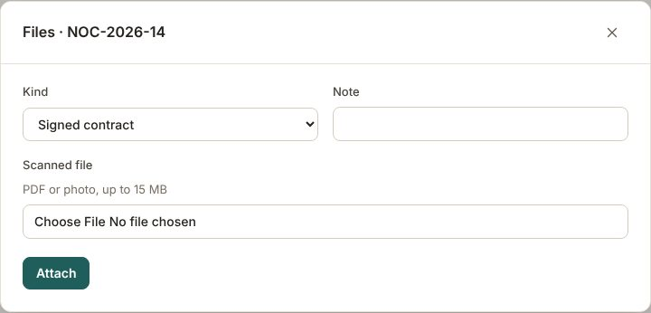

- **Edit** — change the title, dates, payment terms and notes. The change is recorded with who made it.
- **Ending soon** — 30 days before the "valid to" date the home screen shows a reminder, so the contract is renewed or ended on time.

Contracts are optional. Small, one-off or verbal work needs no contract.

#### 5.3.5 Projects

A project groups several jobs of one customer, for example all the deliveries to one field this year. Choose the **customer**, a **name**, and optionally the **contract** it belongs to. The code (PRJ-0001…) is given automatically.

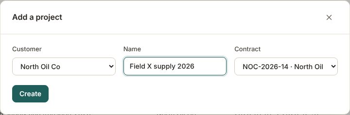

Jobs are put into a project when they are created:

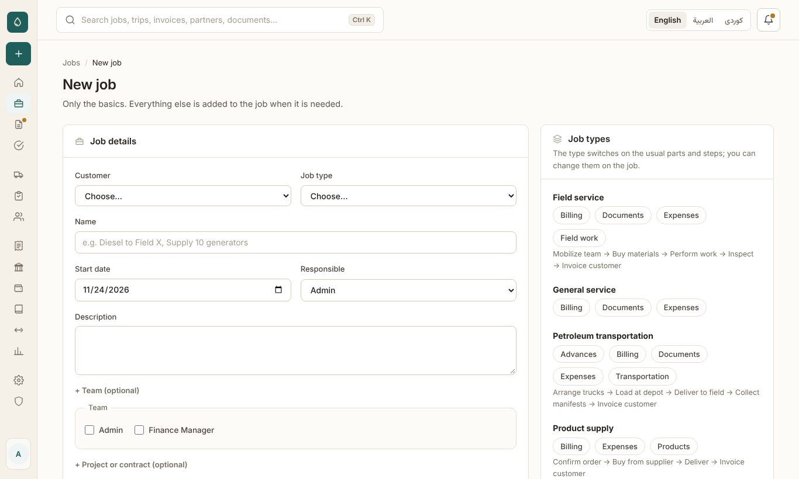

Projects are optional. Most jobs need none.

#### 5.3.6 First-time setup on your live system, in order

1. **Partners**: add your customer(s), e.g. North Oil Co, with the role Customer.
2. **Job types**: add *Petroleum transportation* with Transportation, Advances, Billing, Expenses and Documents, and its five steps. Add the other types only when you start that kind of work.
3. **Document types**: add *Manifest*. Add other papers as customers ask for them.
4. **Document rules**: *Manifest* · for Job type: Petroleum transportation · each trip · before completion · reason "every trip needs its manifest".
5. **Custom fields**: only if a customer asks for a reference on every job, e.g. "Customer PO / reference", shown on that customer's jobs, required before financial close.
6. **Contracts and projects**: only if you want jobs grouped under an agreement or a project.

Then continue with 5.4 and with the first job in section 6.

### 5.4 People and permissions

Administration → Users & roles.

The new permissions from step 2 are in the Money group: open and post claims, waive shortage fines, approve site settlements.

### 5.5 Kinds of fees

Setup → **Accounting & money** tab → **Kinds of fees**.

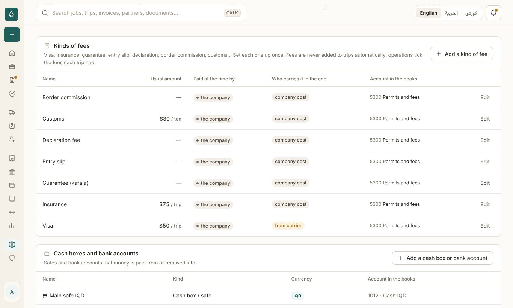

Each kind of fee (visa, insurance, guarantee, entry slip, declaration, border commission, customs, and any you add) is set up once for all jobs. **Add a kind of fee**, or **Edit** on its row:

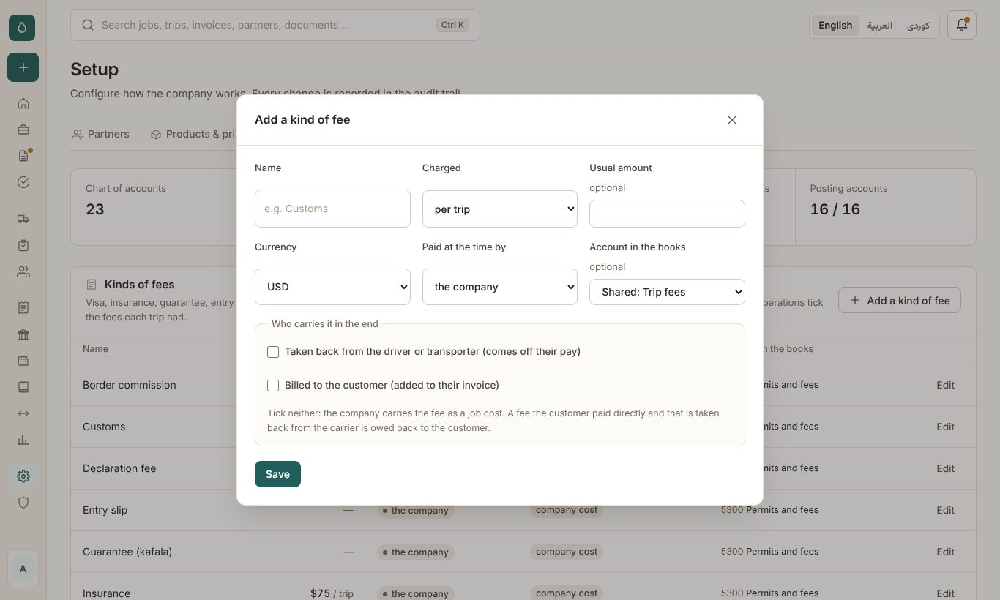

| Field | What it means |
|---|---|
| **Name** | As people say it, e.g. Visa. |
| **Usual amount and currency** | Filled in when the fee is ticked on a trip; it can be changed on that trip. Leave it empty if it changes every time. |
| **Per trip or per ton** | A fixed amount per truck, or an amount per ton loaded. |
| **Who pays it at the time** | **The company** (from a cash box, through "Pay fees") or **the customer directly** (the company pays nothing). |
| **Taken back from the carrier** | The carrier gives it back: it comes off the carrier's pay in the claim. |
| **Billed to the customer** | The customer pays the company back for it on the invoice (step 5). |
| **Account in the books** | Optional. Empty = the shared "Trip fees" account (5300 Permits and fees). Give a fee its own account only if the accountant wants it reported apart. |

Who carries the fee in the end:

| Paid at the time by | Taken back from carrier | Who carries it | What happens |
|---|---|---|---|
| The company | No | The company | A job cost. |
| The company | Yes | The carrier | Comes off the claim. |
| The company | No, but billed to customer | The customer | On the customer's invoice (step 5). |
| The customer directly | Yes | Back to the customer | Comes off the carrier's claim and is **owed back to the customer** automatically (account 2400 "Fees to return to customers"). |

**Fees are never added to trips automatically.** A kind of fee only becomes a cost when someone ticks it on a trip (section 7).

---

## 6. A job and its rule card

### 6.1 Create the job

Click the **+** at the top of the side menu → New job. Only five things are needed: customer, job type, name, start date, responsible person. **+ Team (optional)** adds the other people who work on it.

The job opens on its Overview with the **Next action**: the one thing the job is waiting for.

**The team.** Each job has one **responsible person**, who answers for it, and any number of **team members**. Change them from the job's Overview → **Team**. Being on a team gives no extra rights: what a person can do still comes from their role. A team member who is not allowed to change the rule card still cannot.

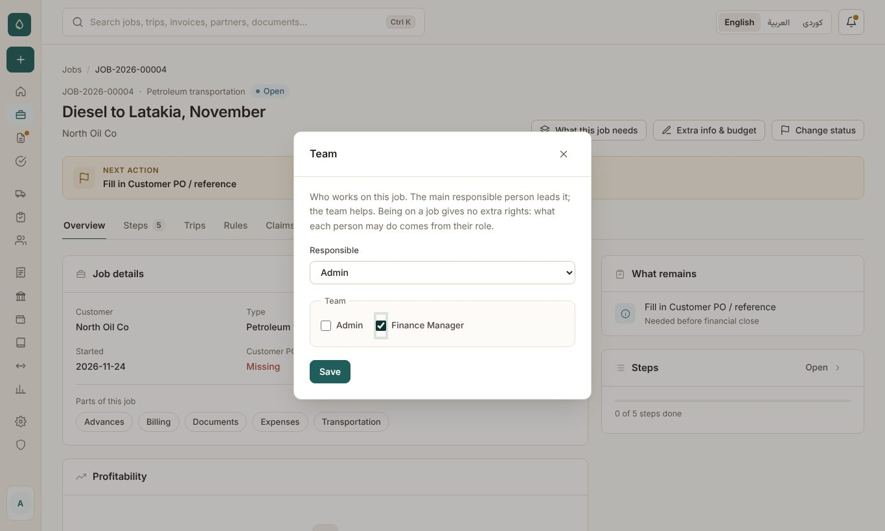

On the Jobs list, **My jobs** shows only the jobs where you are the responsible person or on the team.

### 6.2 The rule card

Job → **Rules** tab. The card has two parts: **Job-wide rules** (this section) and **Prices by route** (6.3).

**Job-wide rules** → **New version**.

| Field | What it means |
|---|---|
| From | The date this version starts. Trips loaded on or after it use it. |
| Currency, unit | The job's currency and quantity unit, e.g. USD and MT. |
| Carrier price, per ton or per trip | What the carrier earns on a route without its own price. Leave it empty if every route has its own. |
| Reward per trip | Added to every trip's freight. |
| Transporter commission | An amount per ton the transporter earns on top, if agreed. |
| Allowance | Shortage per trip the carrier is not fined for, e.g. 0.15 MT. |
| Fine price | Price per ton beyond the allowance, e.g. 1,200 USD. |
| Customer price, allowance, fine | What the customer pays and the customer's own shortage rule. Visible only with the profit permission. Leave the price empty if it is not decided yet. |
| Demurrage | Method, free days, and the rate for the carrier and for the customer. |
| Normal advance, advance limit | The usual advance, and the most that can be paid on a trip without your approval. |

**A price change is a new version from a date.** Old trips keep the old price. Nothing already calculated changes behind your back.

### 6.3 Prices by route

Most of the time only the price and the reward differ between routes, sometimes the shortage allowance. So a route gets only those; everything else (fine, customer side, demurrage, advance limit) stays job-wide.

**Set a route price** → route (pick one, or type a new route's name) → from date → carrier price → reward and allowance only if they differ from the job-wide ones.

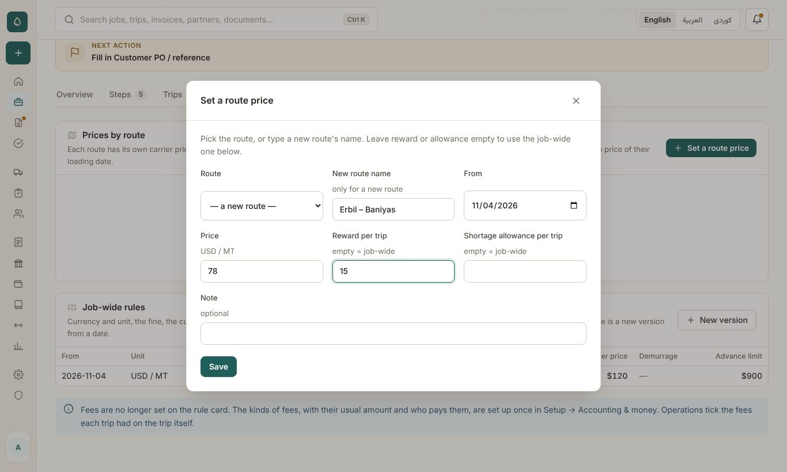

- One price for all carriers on that route.
- Typed fresh on each job: prices are not copied from older jobs.
- A change is a new line from a date. Older trips keep the price of their loading date.
- A trip on a route with no price of its own uses the job-wide price.
- Routes are also created from the trip form and from imported sheets; they then use the job-wide price until you set one.

Fees are no longer on the rule card: they are set up once in Setup (5.5) and ticked on each trip (7.2).

Tip from the owner's seat: fill in the rule card before the first truck loads. A trip loaded before any version exists shows "no rule" until one covers its date.

---

## 7. Trips: loading

Job → **Trips** tab.

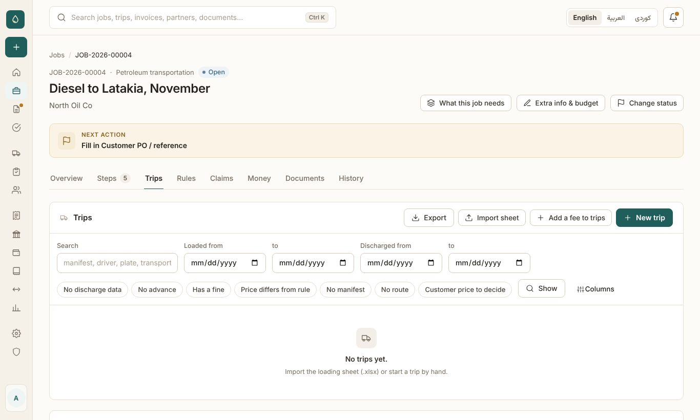

There are three ways to enter trips. They all end in the same trips.

### 7.1 The trip form — one trip with everything

**New trip** opens one screen with every field: manifest, route (or a new route's name), dates, quantities, driver, transporter, plate, a price or reward for this trip only, the transporter's cut, other deductions, notes, an advance with its cash box, and the fees.

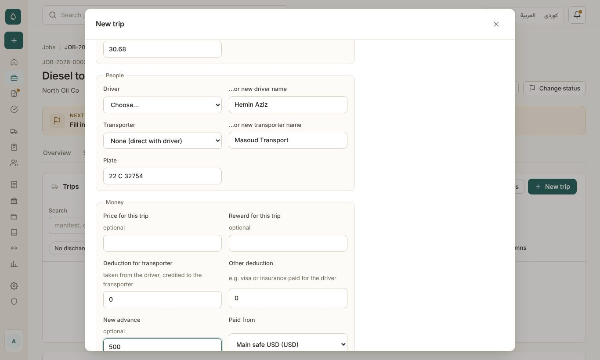

A new driver, transporter or route is typed by name and created on save. An empty transporter means the driver works directly with you.

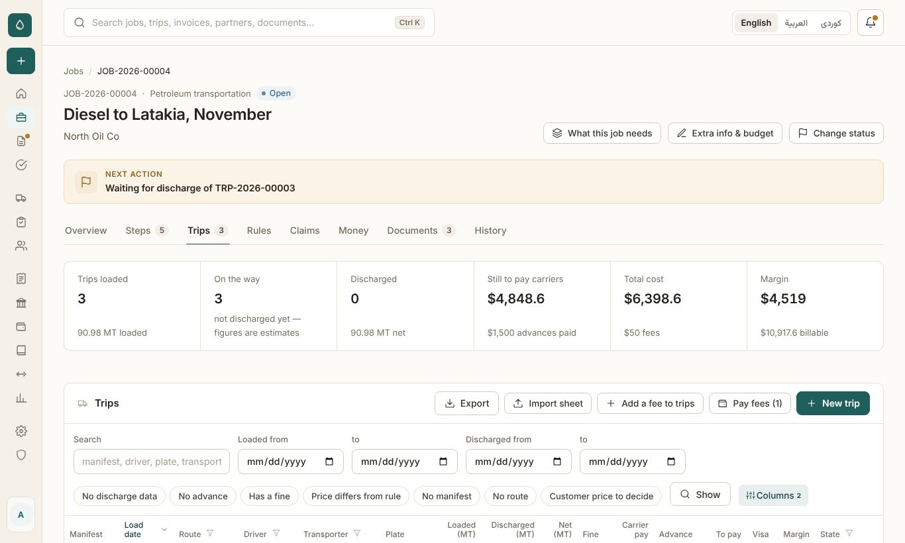

### 7.2 Fees on a trip

At the bottom of the trip form, **Fees this trip had** lists every kind of fee. Tick only those this truck really had. The usual amount is filled in; change it if the paper says otherwise. Untick a fee to remove it.

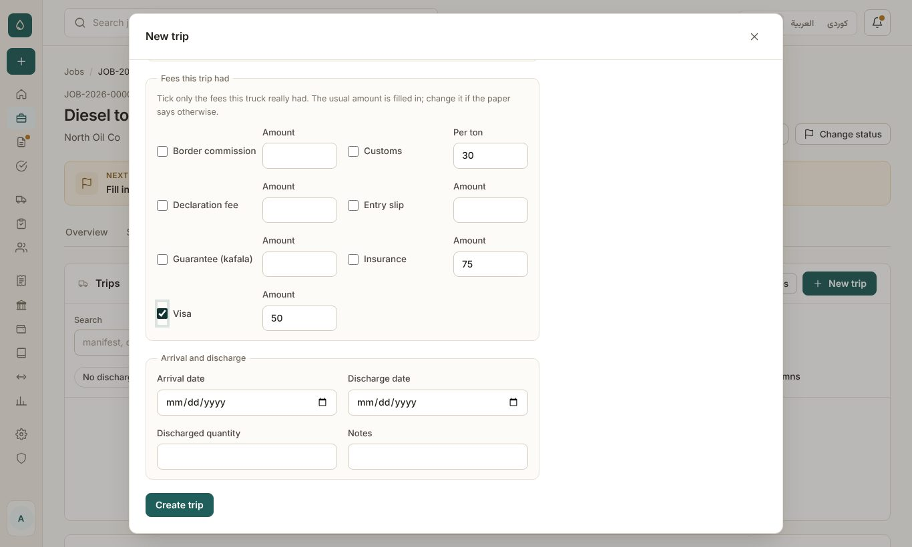

- A fee marked "paid by the customer" costs the company nothing; if it is taken back from the carrier it is owed back to the customer.
- A fee already paid (see "Pay fees") cannot be changed on the trip. Reverse its payment first.
- An imported sheet can carry fee columns; they are ticked the same way.

**One fee on many trucks.** Trips tab → **Add a fee to trips** → the kind of fee, the amount (empty = usual), and the manifest numbers, one per line. Trips that already have that fee are left as they are.

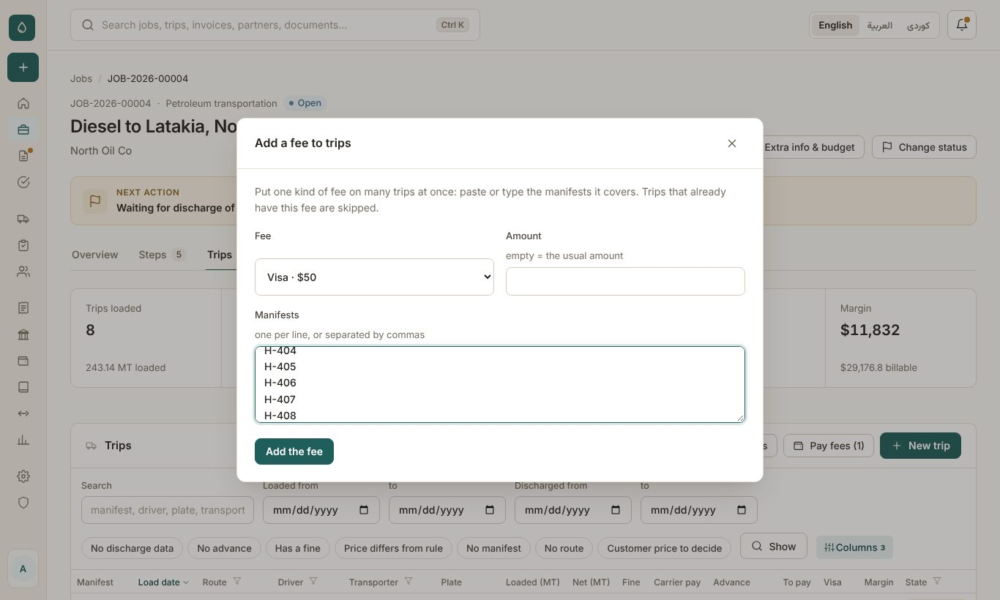

**Pay fees.** Trips tab → **Pay fees (n)** lists the fees the company still has to pay, by kind and currency. Open one kind, untick any fee you are not paying now, choose the cash box and the date → **Pay**. It is one payment out of the box; the books show each fee on its own job. Above the payment limit it waits for approval.

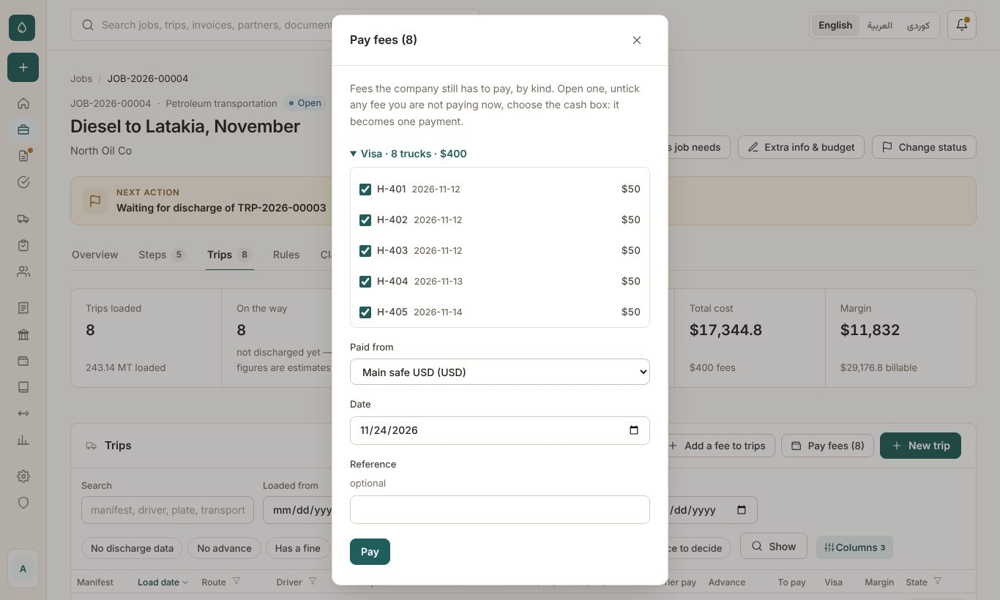

### 7.3 Import the site's sheet

**Import sheet** → choose the .xlsx file → **Preview**.

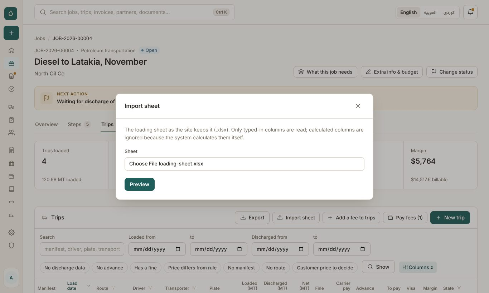

The sheet is read as the site keeps it. Headers in Kurdish, Arabic or English are recognised: load date, route, transporter, driver, plate, manifest, loaded, advance, cash box (سندووق / الصندوق / Cash box), discharge date, discharged, fees and deductions. Columns with formulas are ignored, because the system calculates them itself.

The preview shows what will happen before anything is saved: new trips, updates, unchanged rows, rows with errors and why, new names that will be created, and the advances in the sheet with the cash box they were paid from. Check the new names: a name spelled differently becomes a second person.

**Create and update** applies it once. Rows with errors are skipped; fix the sheet and import it again.

### 7.4 Many rows at once

**Enter many rows at once**, under the grid, opens a spreadsheet-like table for a batch typed from paper. One Save checks all rows together.

### 7.5 Advances

An advance paid when the trip is entered comes out of the chosen cash box straight away.

- Within the rule card's advance limit: paid without asking.
- Above the card's limit: always waits for your approval, whatever the payment limit.
- No limit on the card: the general payment limit applies.
- An advance in another currency than the job's is shown separately and never mixed into the job's currency.

**Advances in an imported sheet.** The advance column records money the site already gave the driver; nothing is sent. Each advance is booked to the **driver** on that row (even when he drives for a transporter), dated on the loading date, with the manifest as its reference, out of a cash box:

- **The cash box column.** If the sheet has a column *سندووق* / *الصندوق* / *Cash box*, each row's advance comes out of the box it names. Write the box's name as it is in Setup (capitals and extra spaces do not matter). An unknown name stops that row, and the preview says so. One sheet can mix boxes and currencies; the preview shows the total per box.
- **Rows without a box** use the box you choose when applying. The choice is asked only when such rows exist.
- An advance from a box in another currency than the job's is checked against the payment limit of that currency, since the rule card's limit is in the job's currency.

A sheet import refuses advances above the card's limit; enter that one trip in the full form and send it for approval.

**Importing the same sheet again never pays an advance a second time.** Only missing discharge data is filled in. If the sheet's advance for a trip that already exists does not match what is recorded (or none is recorded), the preview shows a warning on that row and changes nothing: correct the trip in its form.

### 7.6 What the cards above the grid tell you

Trips loaded, on the way (not discharged, figures estimated), discharged, still to pay carriers with the advances already paid, total cost with the fees the company pays, and the margin (profit permission only).

---

## 8. Discharge, corrections and how a trip is calculated

### 8.1 Import the storage's discharge list

The storage's list needs only three columns: manifest, discharge date and discharged quantity. Import it the same way.

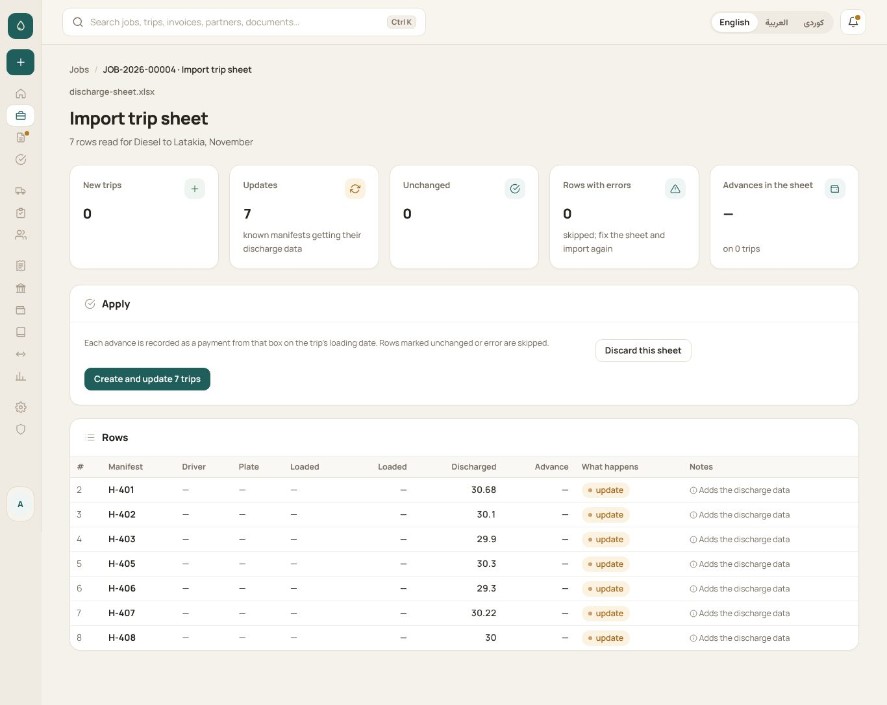

Known manifests get their discharge data. A re-import never overwrites figures already recorded; a different figure is shown as a note instead.

### 8.2 By hand

Open the trip (click its manifest), fill in discharge date and quantity, save.

### 8.3 Corrections

Staff correct a trip directly; mistakes are frequent and waiting for permission delays the work. Write the reason in the form. The trip's **History** shows who changed what, from what to what, and when.

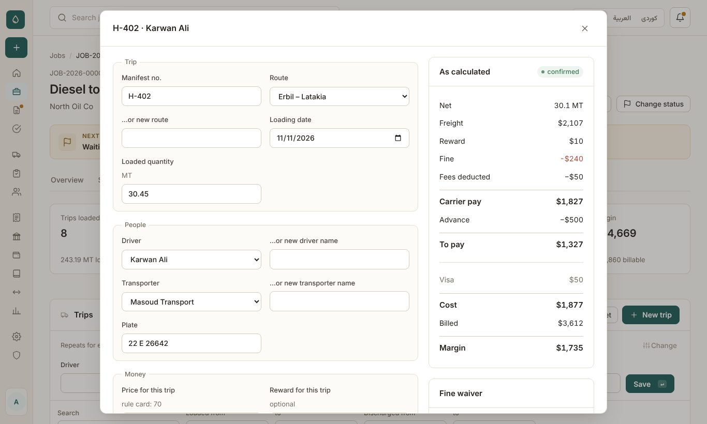

Once a trip is on a claim it is locked: its money has moved. To correct it, cancel the claim first.

### 8.4 How the money is calculated — worked example

Trip H-402, from the screenshots: loaded 30.45 MT, discharged 30.1 MT, on the Erbil – Latakia route, which uses the job-wide price.

| | Rule | Amount |
|---|---|---|
| Net | the lower of loaded and discharged | 30.1 MT |
| Shortage | 30.45 − 30.1 | 0.35 MT |
| Fined quantity | shortage beyond the 0.15 allowance | 0.2 MT |
| Freight | 30.1 × 70 | 2,107 |
| Reward | per trip | + 10 |
| Fine | 0.2 × 1,200 | − 240 |
| Visa | ticked on the trip, taken back from the carrier | − 50 |
| **Earned** | | **1,827** |
| Advance | paid at loading | − 500 |
| **To pay** | | **1,327** |

Until discharge the trip shows the same calculation with net = loaded and no shortage, marked **estimated**. After discharge it is **confirmed**.

---

## 9. Finding and checking trips

The trips grid works like a spreadsheet.

- **Search**: manifest, driver, plate, transporter.
- **Date ranges**: loaded from/to, discharged from/to.
- **Quick chips**: no discharge data, no advance, has a fine, price differs from the rule, no manifest, no route, customer price to decide.
- **Column funnels**: tick the values to show, like Excel's filter.
- **Sorting**: click a column title.
- **Columns**: "Fit to screen" hides the least important columns on small screens; tick to choose your own.
- **Export**: the rows you see, to Excel.

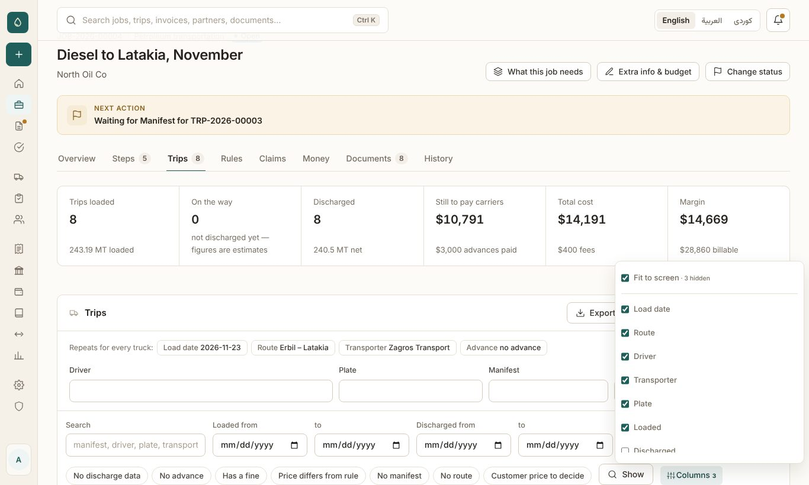

The filters live in the page address: bookmark or send a filtered view to someone.

The **Trips** page in the side menu shows all trips of all jobs with the same tools and a job filter.

---

## 10. Papers

Job → **Documents** tab shows every required paper per trip and its state: missing, received, verified, rejected, expired, or not coming.

You rarely need to record manifests here one by one: when a claim is opened, tick the papers that came with it and they are recorded on every trip of the claim. A received paper, verified or not, blocks nothing.

**Paper not coming.** When a paper will never arrive (lost, the site never sends it), click **Paper not coming** on its row, write why, and **Send for approval**. It goes straight to Approvals; nobody approves their own request.

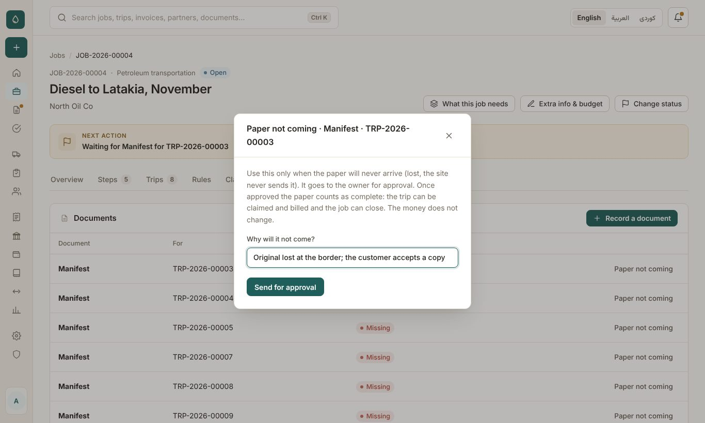

While it waits, the row shows "Waiting for approval". Once approved the paper counts as complete everywhere: the trip can be claimed and billed and the job can close. The money does not change. If rejected, the paper is missing as before.

---

## 11. Fine waivers

When you accept a driver's excuse for a shortage: open the trip → **Fine waiver** → amount (empty = the whole fine) and the reason → **Request a waiver**.

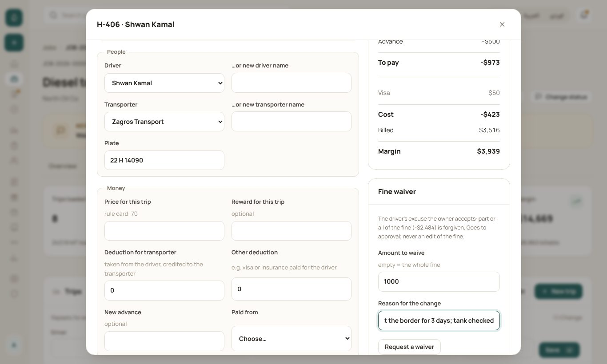

- It always goes to Approvals and a different person decides.
- While it waits, the trip is held back from claims, so a claim never goes out with a fine that is about to change.

After approval the fine is reduced in the trip's calculation and in its claim. The fine itself is never edited; the waiver is a separate record with its reason.

A waiver is only possible before the trip is claimed.

---

## 12. Claims

### 12.1 Open a claim

Job → **Claims** tab → **New claim**.

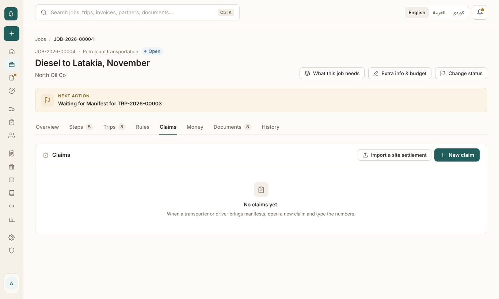

1. **Claimant**: the transporter or the driver who brought the papers. A new name becomes a new transporter.
2. **Date.**
3. **Manifest numbers**: one per line, or separated by commas. Type, paste or scan them.
4. **Papers that came with this claim**: the Manifest is ticked; tick any other paper they brought.
5. **Check the manifests.**

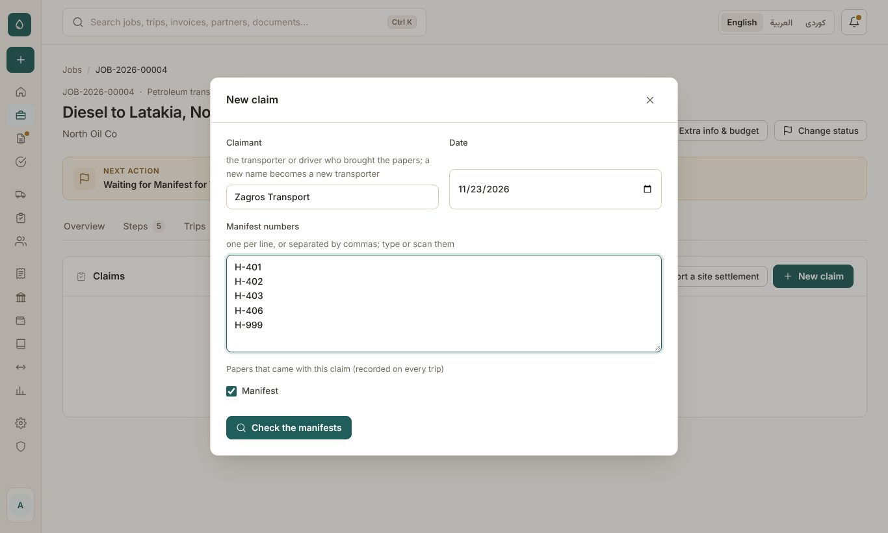

### 12.2 The check

Every manifest gets a result before anything is created:

| Result | Meaning | What to do |
|---|---|---|
| Ready | Can be claimed; amount shown | — |
| No such manifest in this job | Wrong number, or another job's trip | Check the paper |
| No discharge data yet | Not discharged | Import or enter discharge |
| Papers missing | A required paper is not there | Tick it if it came with the claim, record it, or ask for "Paper not coming" |
| Waiver waiting for approval | A fine waiver is undecided | Decide it in Approvals |
| Already claimed | On another claim (number shown) | Nothing: it cannot be paid twice |
| Already paid by settlement | Paid the old way, before claims existed | Nothing |
| Listed twice | The same number typed twice | — |
| No rule card for its date | No version covers its loading date | Add a version |

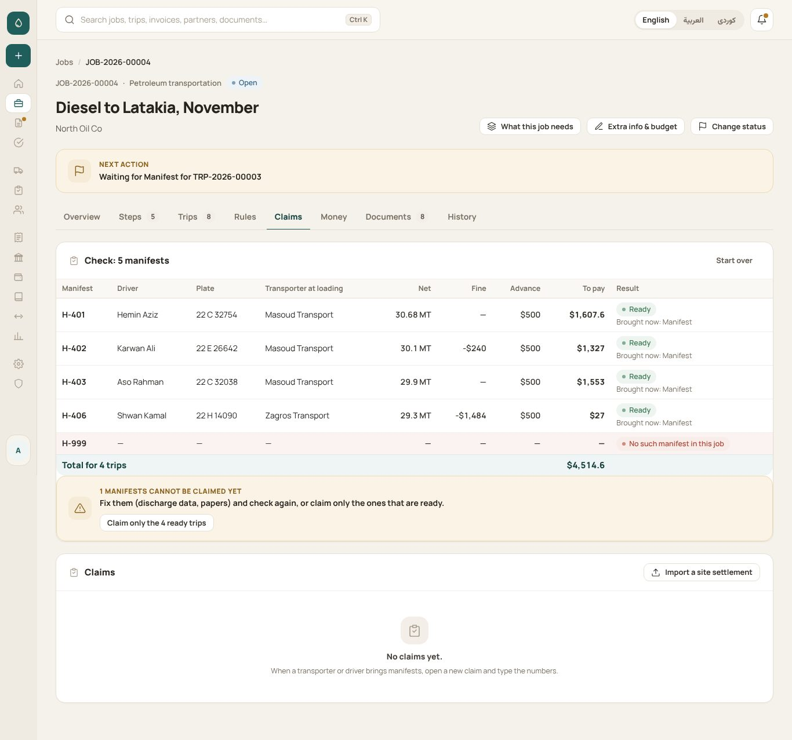

If some lines are not ready, **Claim only the ready trips** keeps the good ones.

### 12.3 Post the claim

**Create and post the claim** opens the claim page, laid out like your settlement form.

The first figure at the top is the one to act on: what the company still owes the claimant. Below the trips, **How the amount is worked out** walks from freight to the amount to pay, ending on a green line; people who may see the books also get **In the books**, the claim's debit and credit lines, which always come to the same total on both sides.

At that moment:

- the claimant's account shows what the company owes them;
- the advances paid on those trips are cleared, from whoever received them;
- the trips are locked and can never be claimed again by anyone;
- the claim's total is rounded once.

Money follows the papers: in the example Zagros Transport brings four manifests, three of them loaded with Masoud Transport's trucks. Zagros is paid for all four. Masoud is owed nothing for them.

A trip whose fine is bigger than its pay has a negative amount. It is offset inside the claim. If the whole claim is negative, the claimant owes the company and the button says **Collect**.

### 12.4 Pay the claim

Claim page → **Pay** → amount (empty = everything still open) → cash box → date → method.

Pay all or part. Each payment shows on the claim and the claim's "Still to pay" goes down.

A payment above the payment limit asks for approval. **Send for approval** puts it in Approvals.

When nothing is left open, the claim shows **Paid**.

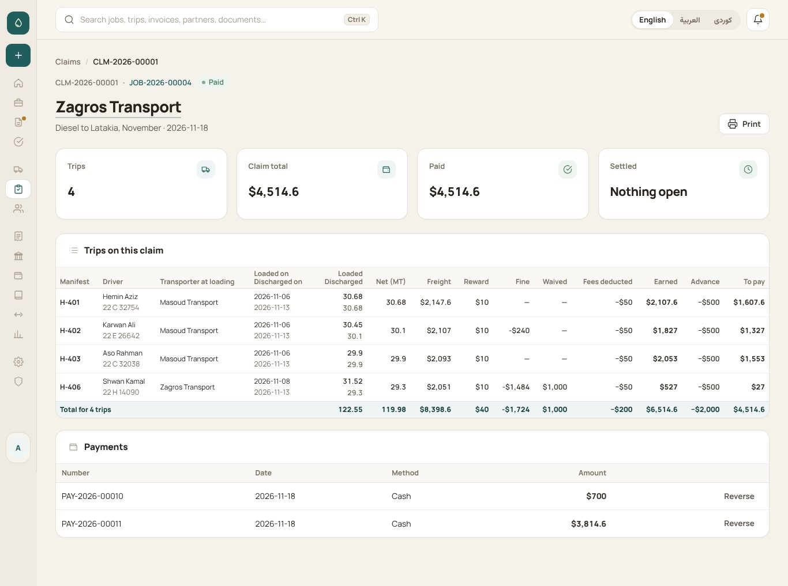

A claimed trip shows a green "Claimed" notice in its form and is locked.

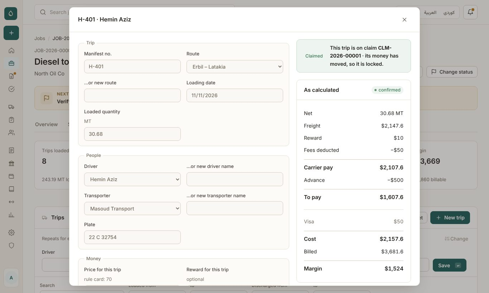

### 12.5 Cancel a claim

**Cancel this claim** with a reason. The trips become claimable again and the booking is reversed. A claim with payments cannot be cancelled: reverse its payments first, with **Reverse** next to each payment on the claim page. Reversing needs the "reverse payments" permission.

---

## 13. Site settlements

When a site paid the drivers with its own figures and sends back a sheet.

Job → Claims tab → **Import a site settlement** → the sheet, the date paid, the site's cash box → **Compare**.

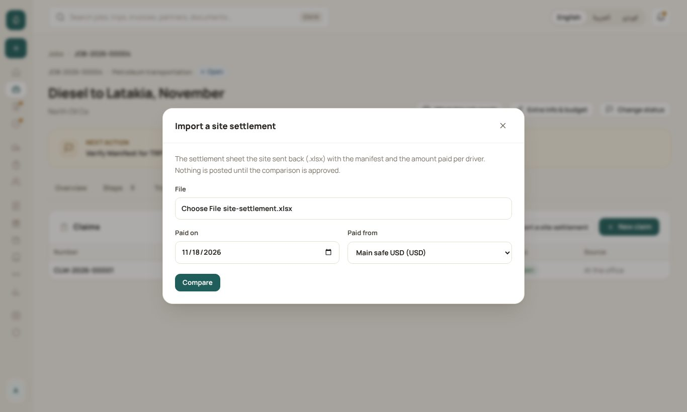

The sheet needs a manifest column and an amount paid column; driver, plate, fine and advance columns are kept for reference. Headers in any of the three languages.

The comparison shows:

- how many lines match, how many differ, and how many cannot be claimed and why;
- per driver: what the system says is owed, what the site paid, and the difference;
- every line, with the result.

**Approve** turns each driver's paid trips into that driver's claim and records the payment from the site's cash box for what the system says is owed. Lines that cannot be claimed are listed and left for later. If the payments are above the limit, the whole settlement waits for approval.

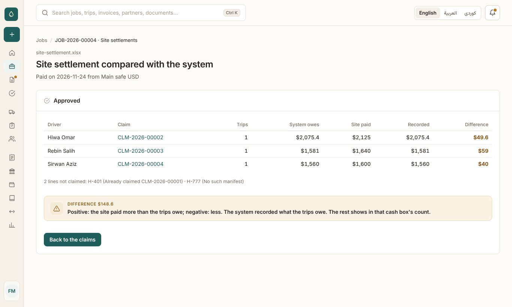

The difference is what the site paid too much (positive) or too little (negative). It stays visible here and, from step 3, appears in that cash box's count, so it is followed up with the site's employee.

---

## 14. Approvals

Side menu → **Approvals**. Everything waiting for a second person:

- advances above a job's advance limit;
- payments above the payment limit;
- fine waivers;
- papers not coming;
- fee payments above the payment limit;
- site settlements above the limit;
- write-offs.

Approve or reject with a note. Nobody can approve their own request. An approved request runs exactly as it was submitted.

---

## 15. Where the money shows in the books

The books hold only real events. While trips are loading, the system calculates profit live from the trips; it does not book estimates.

| Event | What the books record |
|---|---|
| Advance paid | Cash box down; advance owed by that driver or transporter |
| Fees paid ("Pay fees") | Cash box down; each fee as a cost of its job, on the fee's account (or the shared 5300 Permits and fees) |
| Claim posted | Trips' earnings as a job cost; fines against it; fees taken back from the carrier back to the fee's account; fees the customer paid and the carrier gave back owed to the customer (2400 Fees to return to customers); advances cleared; the claimant is owed the net |
| Claim payment | Cash box down; the claimant is owed less |
| Fine waiver | No entry of its own; the claim is smaller |
| Paper not coming | No entry; the paper counts as complete |
| Site settlement approved | A claim and a payment per driver, as above |
| Claim cancelled | The claim's entry reversed |

Where to see it:

- **Partner accounts** → the carrier: balance, claims and every movement. On a claim page, click the claimant's name.

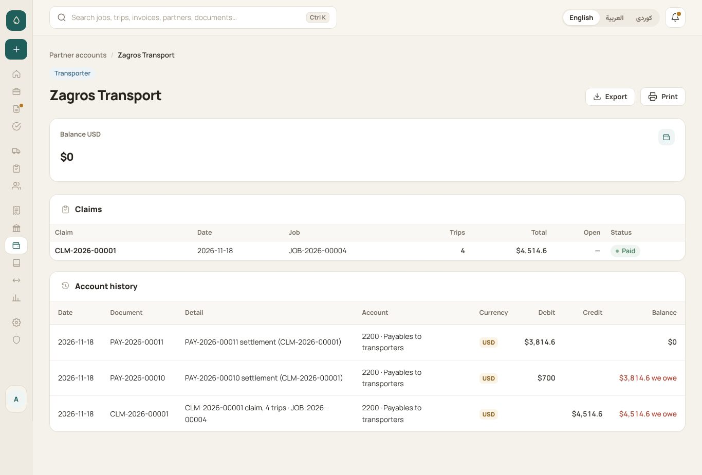

- **Journal**: every entry, each linked to its claim or payment number.

- **Cash, bank & books**: each cash box's balance.

---

## 16. Where to find everything

| What | Where |
|---|---|
| A job's trips, rules, claims, papers | Jobs → the job → tabs Trips, Rules, Claims, Documents |
| All trips of all jobs | Side menu → Trips |
| All claims and their status | Side menu → Claims |
| What a carrier is owed | Partner accounts → the name, or click the claimant on a claim |
| What waits for you | Side menu → Approvals (a dot shows when something waits) |
| Cash box balances | Cash, bank & books |
| Every booking | Journal |
| Cash boxes, limits, papers, kinds of fees, contracts | Setup |
| Fees still to pay | Job → Trips → Pay fees |
| Your own jobs | Jobs → My jobs |
| People and permissions | Users & roles |

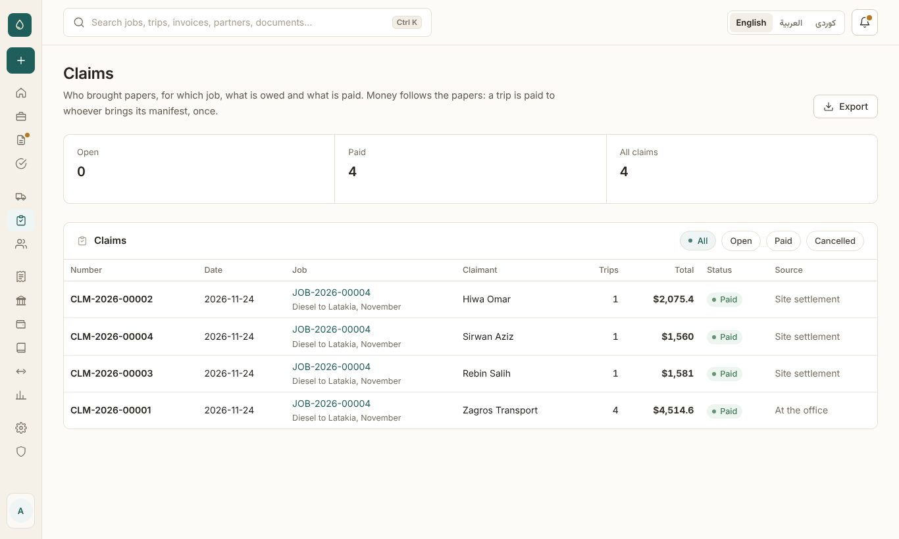

The side menu is a strip of icons; move the mouse onto it to open it, or pin it open with the arrow at its bottom.

---

## 17. What can go wrong and how to fix it

| Situation | What to do |
|---|---|
| A quantity or date was typed wrong | Open the trip, correct it, write the reason. If the trip is claimed, cancel the claim first, correct, claim again. |
| The same manifest typed twice | The system refuses it. Check which trip is right. |
| The preview says a cash box is not known | Write the box's name in the sheet exactly as in Setup, or remove the cell and choose the box when applying. |
| The preview warns that an advance does not match the trip | Nothing was paid. Check the paper: add the missing advance in the trip's form, or reverse a wrong one from the trip's History. |
| A trip shows "no rule" | Add a rule card version whose date covers the trip's loading date. |
| A fee was ticked on the wrong trip | Untick it in the trip form. If it was already paid, reverse the fees payment first (on the payment), then untick. |
| A fee was paid from the wrong box | Reverse the payment; the fees become unpaid again; pay them from the right box. |
| A paper will never come | Paper not coming, with the reason, and approve it. |
| A sheet is refused or columns are not read | The preview lists the columns it recognised. Rename the header to one of the recognised names, or ask for it to be added. |
| A name in a sheet was spelled differently | It becomes a new person. Correct the trip to the right driver; names will be merged in a later step. |
| An advance went out from the wrong cash box or in the wrong currency | Open the trip → History → "Reverse this advance" with the reason, then pay it again from the right box. Only before the trip is claimed. |
| The wrong claimant was chosen | Cancel the claim and open it again for the right person. |
| A claim was paid from the wrong box | Claim page → Payments → "Reverse" with the reason. The money is back in the box and the claim opens again for that amount. |
| The site's figures differ | The comparison shows each difference. Approve what the system owes; follow up the difference with the site's employee. |
| An approval was rejected | Nothing happened. Correct the request and send it again. |
| The old "Settle this trip" button in the Settlement and billing box | From the first draft. A claimed trip cannot be settled that way, and a trip settled that way cannot be claimed. Use claims for all jobs with a rule card. |

---

## 18. A daily and weekly rhythm

From the owner's seat, so normal work stays quiet and exceptions stand out:

**Every day**
- Trip clerk: enter or import the day's loading before closing. Advances only within the card's limit.
- Documents and claims clerk: import discharge lists as they arrive; open claims as papers come in.
- Cashier: pay open claims from the right box.
- You: clear Approvals once a day.

**Every week**
- Trips page, chip "No discharge data": trucks not discharged after the usual days — chase them.
- Chip "Has a fine": shortages to discuss with carriers before claims.
- Claims page, "Open": what is still owed to carriers.
- Site settlements: compared within two days of the sheet arriving.

---

## 19. Try it — checklist

1. In Setup, check the kinds of fees: usual amounts, who pays, taken back from the carrier.
2. Create a job for a real customer with a team of two, and find it under "My jobs" as the second person.
3. Fill in the job-wide rules, and set a price for one route.
4. Enter three trucks in the trip form, with an advance and the visa ticked; one of them direct with the driver.
5. Import a real loading sheet from a site. Add a fee to all its trips at once, then pay the fees in one payment.
6. Import a discharge list with manifest, date and quantity.
7. Correct one trip and read its History.
8. Use the chips and the column funnels to find trips with fines.
9. Request a fine waiver; approve it as a second user; see the trip change.
10. Open a claim by a transporter who did not load those trucks; include one wrong number; claim only the ready trips.
11. Pay part of the claim, then the rest above the limit; approve as a second user.
12. Try to claim one of those manifests again.
13. Import a site settlement sheet with one difference; approve it.
14. Open the carrier's account and the journal and follow each entry back to its claim.
15. Mark one manifest "Paper not coming" and approve it as a second user.
16. Attach a contract's signed file in Setup and set its payment terms.
17. Switch the language to Kurdish and Arabic and repeat one claim.

---

## 20. Not built yet

| What | When |
|---|---|
| Counting cash boxes; site differences landing on the site's box; daily rate; exchangers; paying in the other currency | Step 3 |
| The accountant's review queue; the month-end accrual for trips waiting for papers | Step 4 |
| Customer invoicing from the rule card, with the fees billed to the customer and the fees owed back to the customer as invoice lines; customer advances; receivables by age. The old "Invoice the customer" button uses the first draft's price list: do not rely on it for jobs with a rule card | Step 5 |
| Roles rebuilt around your staff; "my work" lists; your owner board and phone view | Step 6 |
| Storage, shared overheads, staff and payroll, several companies | Step 7 |
| Accident or contamination recovery charged to a carrier | To be scheduled |
| Paying part of a carrier's whole balance across several claims, oldest first | To be scheduled |
| Merging two spellings of the same driver | To be scheduled |
| Saved filter groups | Your decision pending |
| Extra papers and costs for jobs abroad (question #43) | Your answer pending |
